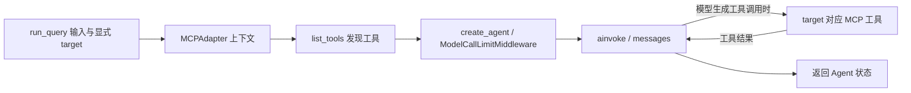

# arch-source-trial-lxbrfcdg · current

日期：2026-11-12。项目：arch-source-trial-lxbrfcdg。状态：**reviewed（静态自审示例）**。文档类型：`current-architecture`。

来源/候选：HEAD 98425ec910407e447c40d5528e84f445d8c38cc8；以下选取文件 hash 见同包验证回执。

## 1. 总体判断与范围

仅静态审阅 agentmcp 与数学 MCP 服务的调用切片。此例用于展示写法，不是完整现状架构，也不作为其他项目事实。

当前 agentmcp 使用内置 MCPAdapter 发现工具，以 create_agent 构建 Agent 并调用 ainvoke。数学服务默认 HTTP，可显式选择 stdio。旧现状文档的 AgentExecutor / 默认 SSE 描述属于升级前快照，应重新核对后再更新；本次创建技能没有改写该文档。

## 2. 当前架构图

图例与事实边界：实线表示已读源码中的调用或返回。数学服务仅在 target 显式指向它时参与，不把默认天气端点误画为数学服务。

本示例保留内嵌 Mermaid 图源；此例图本身未单独渲染，包内五类通用图模板另有渲染证据。

## 3. 模块与真实边界

| 模块 | 入口/来源 | 已实现 | 状态/运行边界 | 未实现/未验证 |
|---|---|---|---|---|
| agentmcp | `agentmcp/agentmcp.py:12` | MCPAdapter、create_agent、模型调用上限 | 连接在 async with 范围内 | 不由静态阅读证明实际 provider 成功 |
| 数学工具服务 | `mcp_server_math/main.py:44` | 默认 http，显式 stdio | 独立进程、默认 8001 | 不由启动分支证明服务已部署 |

## 4. 关键业务链与异常

`run_query → MCPAdapter → list_tools → create_agent → ainvoke → 返回状态`。工具执行取决于模型生成的 tool calls；该函数没有另写手动工具循环，适配器退出上下文时关闭连接。未执行时不填充真实工具或模型成功回执。

## 5. 差距与证据限制

本切片没有证明统一持久化目录、分布式任务状态或业务接受。旧总体现状文档与新源码的差异是后续修订输入，不在本次技能写集中自动更新。

临时非 Git 项目中用内置 current 模板生成并逐项填写，以 archkit check 验证未填变量、JSON/本地链接。语义为当前 Agent 自审；未调用模型或业务服务，未做独立 Agent 盲测。
