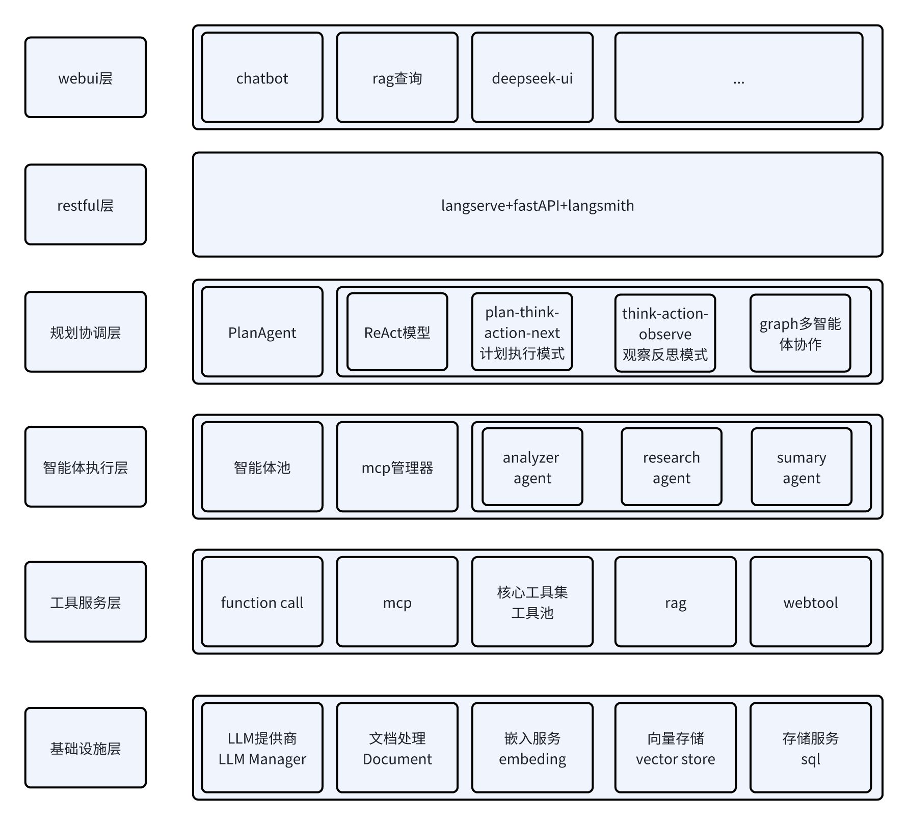
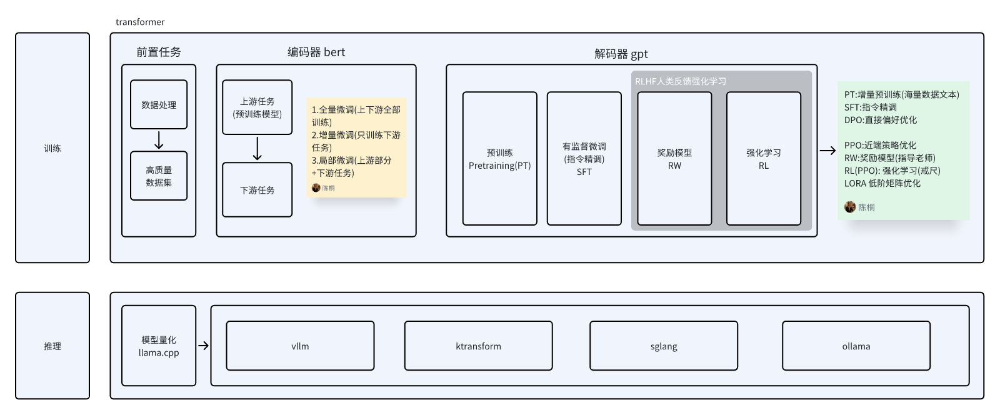

# AI项目架构 用于商业项目实战

## Python 3.12 本地环境与依赖安装

项目统一使用 **Python 3.12**（当前基线 3.12.15），所有当前 Agent/MCP、WebUI/RAG、LangServe、开发测试依赖及本地包均直接列在根 `requirements.txt` 中。在仓库根目录执行：

```bash
python3.12 -m venv .venv
source .venv/bin/activate
python -m pip install -r requirements.txt
python -m pip check
```

整个仓库只保留根目录这一个 `.venv`，所有子模块共享它，不在子目录中创建环境。每次新开终端后先执行 `source .venv/bin/activate`。PyCharm/其他 IDE 的项目解释器选择根 `.venv/bin/python`，各模块设为继承项目解释器。安装时使用 `python -m pip`，避免误用系统 Python 3.9 的 pip；根 `.python-version` 不会自动切换普通 shell 的解释器。

`requirements.txt` 同时包含固定版本的第三方库和 `-e ./...` 本地包，单次安装即可完成，无需分组、锁文件目录或额外安装脚本。新增或修改依赖直接编辑该文件，然后重新安装并执行依赖检查。

LangServe 使用基础包 `langserve`，其所需 FastAPI、SSE 等依赖在根文件显式列出，不启用与 MCP 的 SSE 约束冲突的 `[server]` extra；两者使用同一个环境中的 `sse-starlette==3.7.0`。这一组合以项目离线接口、流式响应和 MCP 回归验证为准。

离线回归（不调用真实模型）：

```bash
python -m pytest tests/test_environment_installation.py tests/s01/test_native_features.py tests/s01/test_mcp.py tests/s01/test_existing_workflows.py tests/s01/test_langserve.py tests/s01/test_ui_rag.py agent_muti_discussion/src/tests/test_discussion.py -q
```

直接执行 `python main.py` 会请求真实 Embedding 服务，不属于离线安装检查。`rag_llamaindex/` 是保留自身依赖的独立历史 GPU 实验，不包含在当前 LangChain UI/RAG 安装范围中。S01 文档中的分环境和锁文件路径是历史记录，当前安装方法以本文为准。

##  1. OpenAI API HK代理

```bash
#HK代理环境，不需要科学上网
export OPENAI_API_KEY='https://api.openai-hk.com/v1'
export OPENAI_API_KEY='hk-xxxxxxxxxxxxxxxxxxxxxxxxxxxxxxxxxxxxxxxxxxxxxxxx'
```
[详见.env配置](.env)

## 2. 费用计算
1 token = 4 chars

1 token = 3/4 words

1000个token 约为750英文单词 (400汉字)


## 3、业务目标
#### [多智能体会议讨论](graph_discussion)

- [x] 1、[技术建议](docs/tech.md)

- [x] 2、[商业建议](docs/business.md)

- [x] 3、[研究建议](docs/research.md)

- [x] 4、[总结建议](docs/summary.md)

- [x] 5、[原始文档](docs/discussion_20251105_13.log)


生成文档来源于[docs](docs)

```shell
cd graph_discussion & python main.py
```

先讨论3轮
```commandline
提示词 搭建一个AI 多agent股票量化软件并且商用落地
```


## 4.AI 项目架构



[架构图实时更新](https://hw59jj30i1.feishu.cn/docx/CXHFdYgRvoy8lnxcy2KcVxTInAb?from=from_copylink)

方向: chatbot + server(restful) + rag + openmanus + (mcp / function_call) + 多agent

### 技术关键目标
tips

- [x] 工具能力抽象 + 动态加载(每个子系项目都考虑扩展问题)

- [x] function_call / MCP ( 支持 [mcp管理](mcp_client_manager) [mcp服务-天气](mcp_weather) [mcp服务-数学](mcp_server_math) )

- [x] agent支持 扩展 (支持[agent-mcp](agentmcp)) 

- [x] 多agent (支持[graph](graph_discussion)/[think-plan-actiob-next](agent_muti))

- [x] restful - api (支持 [langserve](server)) 

- [ ] 前后端分离 

- [x] python WebUI 
 - 1) [webui-chatbot](webui-chatbot)
 - 2) [react前端 deepseek-ui](https://github.com/yinlingchaoliu/deepseek-ui)

- [x] rag外接数据库 [rag项目](https://github.com/yinlingchaoliu/rag_ai)

- [x] 支持监控 (国外 vpn 选langsmith  国内开源 langfuse)

- [x] 支持项目之间隔离

- [x] python库 依赖管理

- [ ] python jni c++

- [x] 支持本地模型

- [x] 基础库抽取 [lib_hello](lib_hello) 工程用于快速开发示例

### AI训练架构图


- 1、[AI基于huggface模型微调(bert/gpt2)](https://github.com/yinlingchaoliu/huggingface_ft)

- 2、[llama3微调](https://gitee.com/yinlingchaoliu/Chinese-LLaMA-Alpaca-3)

- 3、[MedicalGPT微调范式，基于模型训练4个阶段(预训练, 有监督微调,奖励模型,强化学习)](https://gitee.com/yinlingchaoliu/MedicalGPT)

### 环境 python env
```shell
python3.12 -m venv .venv
source .venv/bin/activate
python -m pip install -r requirements.txt
```

### 1.[webui](webui-chatbot) : python编写界面

#### 待做
[chatbot-app](webui-chatbot): 初版chat代码

从界面混合，改成MVC -> 前后端分离

### 2.[ai服务](server): 提供restful api
- [x]  1、支持动态路由注册

- [x]  2、服务健康检查 路由配置查询

- [x]  3、支持openai服务 get/post样例

- [x] 4、支持playground调试

- [x] 5、langserve 可支持 simth (需要申请key)

- [x] 6、增加[测试用例](client/client)测试用例来测试

- [x] 7、适配支持get 配置路径 服务器默认只支持post

- [x]  8、支持[shell请求](client/shell/post.sh), 实际场景只需要post

### 3.[rag外接知识库](rag): 提供rag扩展


### 4.baselib库
1) 原则: 项目sdk之间要隔离
2) 以lib_开头
3) [基础库sdk管理](lib_hello/README.md)

- [x] 1、支持依赖库(本地发布,远程发布)

- [x] 2、lib_request 对openai request简单封装 为复用做准备

- [x] 3、lib_hello 是基础库的模版代码

### 5.mcp 协议

- [x]  编写 mcp-server [天气服务](mcp_weather)

- [x]  编写 mcp-server [计算服务](mcp_server_math)

- [x]  编写 mcp-client-manager [mcp客户端管理,支持LLM自主选择 远程MCP tools](mcp_client_manager)

- [x]  编写 mcp-client-manager 支持动态注册 mcp server

- [x]  编写 mcp-client-manager 实现 LLM 自主决策 调用与实现隔离

- [x]  编写 mcp-client-manager 增加mcp_manager 中间层 用于管理mcp服务 ,给LLM提供tools和调用

- [x]  模型支持调用工具链, 也可以自主回复

本地引用
```shell
# 基础封装 
pip install -e lib_request
```

### 6. [Think-Plan-Action-Next 模式 多agent协调设计](agent_muti)

- [x]  1、增加 Think-Plan-Action-Next 多轮迭代思考 通用化逻辑思考方法论

- [x]  2、支持agent插件平行扩展

- [x]  3、产品场景: 旅游攻略

- [x]  4、[架构设计和产品理念](agent_muti/README.md)

### 7. 多智能体会议讨论 推荐langgraph

- [x]  1、采用智能体传统协作方式开发 [已实现agent_muti_discussion](agent_muti_discussion)
- 1) 智能体交互 需要设计好提示词 返回result数据
- 2) 智能体协调关系比较复杂
- 3) 调整逻辑关系 智能体之间改动比较大

- [x]  2、采用智能体graph协作方式开发 [已实现graph_discussion](graph_discussion)
- 1) 开发需要先确认智能体 graph 图的关系 面向智能体开发
- 2) state 作为上下文参数 可以传递 智能体之间信息
- 3) 智能体之间关系是解耦的 可以独立开发 互不干扰


## 启动项目

### webui-chatbot 模块
```shell
# 启动项目
sh port.sh 1234
streamlit run webui-chatbot/src/home.py --server.port 1234
```

### server 模块

```shell
# 启动项目
sh port.sh 8008
python -m uvicorn app.server:app --app-dir server --port 8008
cd ..
```

```shell
#查询路由表
http://127.0.0.1:8008/routes
#健康检查
http://127.0.0.1:8008/health
```

get请求
```shell
curl -X GET "http://127.0.0.1:8008/get-example/invoke?input=123"
```

post请求
```shell
curl -X POST -H "Content-Type: application/json" -d '{"input":"测试Pydantic处理"}' http://127.0.0.1:8002/post-example/invoke
```

### 通过脚手架 项目工程化
```shell
langchain app new app

pip install poetry
poetry add langchain-openai

poetry run langchain serve --port=8000
```

http://localhost:8000/openai/playground

## git问题
下次 Git 接触时 CRLF 将被 LF 替换
```shell
git config --global core.autocrlf false
```
