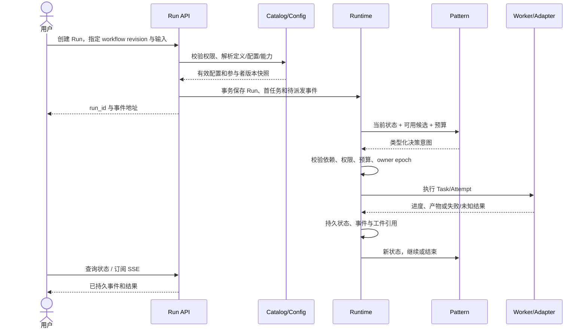

# 01 · 平台分层与模块边界

状态：拟建。总览与范围见[方案入口](README.md)，现状见[源码架构](../current-architecture.md)。

## 1. 六层结构

| 层 | 职责 | 核心模块 | 明确不承担的责任 |
|---|---|---|---|
| L1 接入与应用 | 用户交互、身份解析、API 校验、流式呈现 | Console、Chat、CLI/SDK、Management API、Run API、A2A Server | 不在 HTTP 请求里长期执行任务，不把页面 session 当全局状态 |
| L2 控制面 | 定义、发现、发布、路由资格与治理 | Agent Catalog、配置发布、实例目录、Workflow Catalog、租户策略/配额 | 不逐 token 控制 Agent，不与 Worker 争抢任务状态写权 |
| L3 协作策略 | 决定谁做什么、依赖、审阅、转交及结束 | 四种 Pattern、路由策略、结果聚合器 | 不直接操作数据库、消息队列或供应商 SDK |
| L4 运行内核 | 持久调度、状态机、归属、上下文、重试、取消、恢复 | RunService、TaskScheduler、AttemptRunner、Budget、EventLog、Context/Artifact Service | 不把 LLM 的 finish 文本直接视为成功，不执行任意插件下载 |
| L5 适配与资源 | 统一执行接口、模型/工具/知识访问与隔离 | LocalAgentAdapter、LangGraphAdapter、A2AAdapter、ModelGateway、MCP、RAG、Sandbox | 不自行成为第二调度器，不覆盖父 Run 的定义或预算 |
| L6 基础设施 | 持久化、存储、传输、观测、身份和密钥 | PostgreSQL、对象存储、遥测、Secret Provider；按需加消息系统 | 不承载提示词中的业务决策 |

L2 是控制面；L3–L5 是执行面；L1 为二者提供入口；L6 为二者提供基础能力。身份验证、权限、审计和数据隔离横跨各层，不仅存在于入口。

## 2. 领域边界

| 领域 | 自己拥有的数据/行为 | 向其他领域提供 |
|---|---|---|
| Registry | AgentDefinition、AgentInstance、能力索引、部署健康 | 发布版本查询、候选发现、实例选择 |
| Configuration | ConfigRevision、发布指针、环境覆盖、审计 | 已校验并展开的有效配置快照 |
| Collaboration | WorkflowRevision、Pattern 配置、决策记录 | `Schedule / Review / Handoff / Finish / Wait` 等类型化意图 |
| Runtime | Run、Task、Attempt、运行租约、取消与恢复 | 唯一执行状态、事件和结果引用 |
| Context & Artifact | 上下文快照、可见性、产物、校验和 | 按权限取得的数据视图，支持显式版本引用 |
| Connectivity | A2A 进出站映射、MCP 工具绑定、模型调用 | 统一适配接口与原始远端回执 |

关键规则：Registry 回答“谁具备能力且可调度”，Collaboration 决定“该调用谁”，Runtime 决定“这次派发是否仍有效并如何执行”，Adapter 负责“怎样调用”。远程 A2A 服务拥有其内部任务执行，平台保留远端状态镜像和父级业务判断，两者各有边界。

## 3. 公共对象与 ID

| 对象 | 核心字段 | 含义 |
|---|---|---|
| AgentDefinition | `tenant_id, agent_id, revision, capabilities, runtime_ref, config_ref` | 稳定身份下的不可变定义；显示名不是主键 |
| AgentInstance | `instance_id, definition_revision, endpoint, heartbeat_at, lease_expires_at, health, capacity` | 可消失和扩缩容的运行实例；与定义分开 |
| WorkflowRevision | `workflow_id, revision, pattern, participants, limits, output_contract` | 协作策略定义与版本 |
| Run | `run_id, tenant_id, workflow_revision, resolved_manifest, status, deadline, budget` | 一次用户目标，固定已解析定义/配置/权限与参与者版本 |
| Task | `task_id, run_id, parent_task_id, dependencies, assignee_revision, status, owner_epoch` | 可委派的工作单元，定义输入与输出验收条件 |
| Attempt | `attempt_id, task_id, attempt_no, worker_id, lease, remote_refs, side_effect_state` | 一次实际执行尝试；重试不修改历史 |
| Event | `event_id, run_id, sequence, type, causation_id, payload_ref` | 持久运行事件；状态快照用于查询，事件用于追踪和恢复辅助 |
| Artifact | `artifact_id, producer_attempt_id, schema_ref, uri, sha256, review_status` | 可校验、可追溯的输出；执行完成和验收分离 |

同一上下文可以有多个 Run/Task，不能用 `conversation_id` 代替任务主键。跨系统 `remote_task_id` 必须连同远端 Agent 身份、endpoint、租户路由和协议版本保存，不是平台 Task 的别名。

## 4. 一次运行如何经过各层



调度前会再次检查当前授权、撤销与健康状态。Run 固定历史配置不表示可以绕过后来撤销的权限。动态选取的新参与者，在第一次派发前解析到明确 revision 并追加到 Run manifest；不得在每一轮无记录地跟随 `latest`。

## 5. 两个关键扩展契约

以下为接口语义，实际 Python 类型和 JSON Schema 在第 0 阶段固定，不是当前已存在的 API。

```text
CollaborationPattern.decide(run_snapshot, event, eligible_agents)
  -> Decision[Schedule | Review | Handoff | Finish | Wait]

AgentAdapter.invoke(task_input, execution_context) -> AsyncIterator[AgentEvent]
AgentAdapter.inspect(attempt_ref) -> ObservedExecution
AgentAdapter.cancel(attempt_ref) -> CancelObservation
AgentAdapter.capabilities() -> AdapterCapabilities
```

`AgentEvent` 包括 started/progress/artifact/input_required/completed/failed；未识别的远端事件保留原文并受大小限制。Adapter 显式声明 query/cancel/resume/stream/usage 支持；不支持的能力返回 unsupported。Pattern 的意图由 Runtime 校验和执行，Agent 不能通过返回 JSON 给自己增加权限或启动任意同伴。

LangGraph 子图由 LangGraphAdapter 执行，一个 Attempt 对应独立 `thread_id/checkpoint_ns`。子图内部只组织本地计算；跨平台委派通过 Runtime 任务接口，避免父 Runtime 与子图同时重试同一外部动作。

## 6. 技术选择与部署

| 位置 | 第一版建议 | 依据、代价与扩展条件 |
|---|---|---|
| 语言/接口 | Python + FastAPI + Pydantic | 复用仓库；新增独立依赖环境和锁文件，不能直接合并现有 requirements |
| 协作/流程 | 自有轻量 Pattern 契约 + 受限 LangGraph 子图 | 继承既有图流程；不同时引入多套调度框架 |
| 状态/队列 | PostgreSQL，事务任务表 + `SKIP LOCKED` 领取 + outbox/inbox | 第一版减少组件；状态机和任务重投需要实施与故障测试 |
| 工件 | 本地开发文件后端，部署使用 S3 兼容对象存储 | URI + hash + 权限，不把大文件塞入数据库或全量上下文 |
| 通讯 | 本地适配器；远程使用 A2A HTTP+JSON/SSE | 版本依据见 [03](03-a2a-protocol.md)；多绑定或 gRPC 后置 |
| 模型/工具 | ModelGateway + MCP Adapter | 统一限额、超时、usage 与工具幂等记录；MCP transport 逐服务验证 |
| 观测 | OpenTelemetry 风格 trace/span 契约与结构化事件 | 后端产品按环境确定；不让观测系统成为状态事实源 |
| 部署 | API 进程 + Worker 进程 + DB + 工件存储 | 同一仓库/镜像可支持多种启动角色；代码与工具任务用独立沙箱 |

第一版无需 Kubernetes、Kafka 或独立注册中心服务。独立 Worker 池按任务类别、模型配额、可信等级扩展；只有容量和隔离证据支持时再拆 Registry、Scheduler 或 Gateway 服务。LangGraph 的 checkpointer 与跨线程 store 有不同作用，且内存 saver 不提供进程重启持久性，依据[官方持久化文档](https://docs.langchain.com/oss/python/langgraph/persistence)；本方案仍由平台定义 Run/Task 和副作用语义。

容量目标由第 0 阶段确定；线程数、Worker 数、模型并发和队列积压需要整体预算，不能把 `asyncio.gather` 的并发数当平台吞吐能力。
