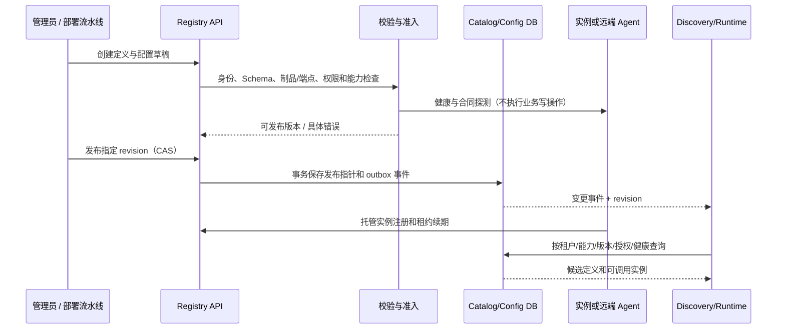

# 02 · 智能体动态注册与配置

状态：拟建。动态注册是运行时加入已部署的可信能力；动态配置是发布可追踪的新配置版本。修改 Python 文件、直接 import 新代码和改写执行中对象不作为平台的配置发布机制。

## 1. 区分定义、配置、部署与实例

| 对象 | 说明 | 生命周期/版本 |
|---|---|---|
| AgentDefinition | Agent 身份、能力、输入输出合同、runtime 类型、配置引用 | 不可变 revision；草稿 → 校验 → 发布 → 废弃/禁用 |
| ConfigRevision | 模型参数、prompt 引用、工具绑定、超时、上下文/预算策略 | 不可变 revision；有效配置在 Run 中固化 |
| Deployment | 把某定义/配置部署到环境或绑定远端服务 | 激活、排空、停止；保存 `desired_revision/observed_revision` |
| AgentInstance | 已运行的进程/容器/远端 endpoint | ready、unhealthy、draining、offline；有健康和容量 |

`agent_id` 在租户内稳定，`revision` 不能覆盖；同一个定义可有多个实例。Definition 的已发布不意味着存在健康实例；发现接口必须区分“目录里存在”和“现在可调用”。默认查询只返回可调用候选。

外部 A2A Agent 可以由管理员绑定服务并由平台探测健康，不要求外部提供平台专属心跳。平台托管 Worker/实例使用短期身份和租约续期。两类健康观察分别记录，不能用 Agent Card 可读替代任务执行健康。

## 2. 注册和发现流程



步骤：

1. 注册者必须有目标租户/命名空间权限；稳定 ID、revision、Schema 和 runtime 类型先校验，重名冲突返回 409。
2. 本地 Agent 只引用构建时允许的制品、镜像 digest 或 entrypoint。新业务代码走构建/部署；管理 API 不接受任意模块路径、pip 包或脚本执行。
3. A2A Agent 由受限出站客户端读取 Card，校验 HTTPS、允许域、协议和认证能力。解析后的地址及跳转仍受出站策略控制；Card 里的描述和技能是数据，不是平台指令。
4. 发布事务保存不可变定义、配置绑定、审计、发布指针和 outbox。事件仅用于加速缓存失效；消费者按 revision 对账，定期拉取修复漏事件。
5. Discovery 先做硬过滤（租户、授权、版本、输入输出模式、工具权限、健康、容量），再按显式规则或模型排序。模型只能从合格候选 ID 中选择。
6. Runtime 派发前重新校验候选和租约，用容量预留防止超卖；发现和实际派发之间的健康变化应触发有界重选。

内部托管实例建议起始值为 10 秒心跳、30 秒租约；它们是待压测参数。租约到期即停止新派发，先对账正在执行的 Attempt。租约过期不证明旧进程和外部副作用已停止。

## 3. 定义示例

以下是平台自有 Manifest 示例，**不是 A2A Agent Card，也不是现有代码配置**。解析器和 Schema 在实施阶段创建。

```yaml
apiVersion: platform.ai/v1alpha1
kind: AgentDefinition
metadata:
  tenant_id: demo
  agent_id: research-expert
  revision: 3
  display_name: 研究专家
spec:
  runtime:
    type: local_python
    implementation_ref: builtin/research-expert@sha256:EXAMPLE_DIGEST
    isolation_profile: trusted-readonly
  capabilities:
    - id: topic-research
      version: "1.0"
      input_schema_ref: schemas/topic-research.input.v1.json
      output_schema_ref: schemas/research-report.output.v1.json
  config_ref: research-expert-config@7
  allowed_patterns: [orchestrator_worker, supervisor, handoff, swarm]
  permission_profile_ref: research-readonly@2
  limits:
    max_concurrency: 2
    task_timeout_seconds: 120
```

```yaml
apiVersion: platform.ai/v1alpha1
kind: AgentDefinition
metadata:
  tenant_id: demo
  agent_id: partner-research
  revision: 1
spec:
  runtime:
    type: a2a_remote
    card_url: https://research.example.com/.well-known/agent-card.json
    protocol_version: "1.0"
    protocol_binding: HTTP+JSON
    auth_profile_ref: partner-research-service-account
    endpoint_policy_ref: approved-partner-domains@1
  capabilities:
    - id: topic-research
      version: "1.0"
      input_schema_ref: schemas/topic-research.input.v1.json
      output_schema_ref: schemas/research-report.output.v1.json
  config_ref: partner-research-config@1
  permission_profile_ref: remote-research@1
```

示例中的 schema、制品、权限 profile 和服务均为占位引用；在引用解析和部署核验之前不能发布。能力 Schema 是平台的业务合同，A2A 的技能描述不自动提供等价强类型验证。

## 4. 配置内容与优先级

```yaml
apiVersion: platform.ai/v1alpha1
kind: AgentConfig
metadata:
  config_id: research-expert-config
  revision: 7
spec:
  model_profile_ref: research-default@2
  prompt_ref: prompts/research-expert@5
  model_parameters:
    temperature: 0.2
    max_output_tokens: 2000
  tools:
    - binding_ref: knowledge-search@3
  credentials_ref: secret://demo/model-provider
  execution:
    timeout_seconds: 120
    max_steps: 8
    max_tool_calls: 6
  context:
    projection_ref: research-input-only@1
    max_input_tokens: 12000
```

有效业务配置依次合并：平台默认 → 租户/环境覆盖 → 已发布 AgentConfig → Workflow 覆盖 → 本次 Run 允许覆盖项。后者不能任意改前者：只有 Schema 标记为可覆盖的字段才允许覆盖；输出必须记录来源和配置 hash。

权限和预算采用收紧规则：有效权限取各层授权的交集，有效上限取适用上限的最小值。Run 不能通过传入参数扩大工具权限、模型权限、外部域范围或全局预算。密钥仅保存引用，Worker 按有效身份临时取得；快照、Card、日志、前端和工件均不得含密钥值。

## 5. 发布、生效与回滚

| 变更 | 生效策略 | 已运行任务 |
|---|---|---|
| Prompt、模型、工具、能力 Schema | 新建 revision，经校验后切换发布指针 | 继续使用已固定 revision；显式迁移才能切换 |
| 描述和标签 | 也保留审计版本；能力变化需重新检查 | 不改变已确定参与者 |
| 并发、限流和熔断 | 运行时运营策略，可收紧；变更有审计 | 不撤销已发生动作；约束后续派发 |
| 授权撤销、禁用和密钥吊销 | 安全策略立即生效，广播并在调用前复核 | 阻止后续动作；按运行策略取消并对账 |
| 制品/入口实现 | 新构建和新部署，不原地热改解释器 | 旧实例排空；旧 Run 按保留策略使用旧制品 |

发布指针更新要求 `If-Match` 或 `expected_revision`；两个操作者竞争发布只有一个成功，另一个返回冲突。预检通过后可先给测试租户或新 Run 灰度。回滚是把指针切回已验证 revision，保留失败版本和审计记录，不篡改历史 Run。

缓存包含 `catalog_revision` 和 TTL；新 Run 的解析在服务端校验发布指针，不能只信事件缓存。控制面不可用时，已固定版本的运行可以在仍能校验授权的前提下继续；无法验证撤销状态时停止新的敏感派发。新注册/新发布返回可重试的不可用，不编造成功。

## 6. 下线与删除

`drain` 先让实例停止接收新任务，等待在途任务完成或到截止时间；超过排空期限按策略取消、查询和对账。`disable` 作用于定义/部署并阻止新任务；强制撤销另走立即停止策略。

删除优先逻辑删除，不能破坏历史 Run 对 revision 的引用。定义禁用、实例离线和进程停止是不同事实。远端不支持取消时应保留 `cancel_requested + remote_unknown` 并明确展示，不能标成已经停止。

## 7. 管理接口草案

下表是平台自有 REST API，与 A2A 协议接口分开。

| 方法与路径 | 语义 |
|---|---|
| `POST /api/v1/agents` | 创建稳定 Agent 身份 |
| `POST /api/v1/agents/{id}/revisions` | 创建不可变定义草稿 |
| `POST /api/v1/agents/{id}/revisions/{rev}:validate` | 校验合同和可调用性，返回逐项证据 |
| `POST /api/v1/agents/{id}:publish` | CAS 发布定义/配置绑定 |
| `GET /api/v1/agents?capability=...` | 带租户授权的目录和可调用候选查询 |
| `POST /api/v1/instances`、`POST /api/v1/instances/{id}:heartbeat` | 托管实例注册/续租，身份必须绑定实例 |
| `POST /api/v1/agents/{id}:drain`、`:disable` | 排空或禁用，记录操作者与范围 |
| `POST /api/v1/configs/{id}/revisions`、`POST /api/v1/configs/{id}:publish` | 配置校验与 CAS 发布 |

租户来自认证主体，不接受 body 任意指定越权租户；每个读取、发布、发现和实例操作都做权限校验。A2A Card 采用 well-known、受管目录或私有配置等发现方式，依据[官方 Agent Discovery](https://a2a-protocol.org/latest/topics/agent-discovery/)；本平台的数据库、租约和发布策略是工程设计，不属于 A2A 自动提供的能力。
