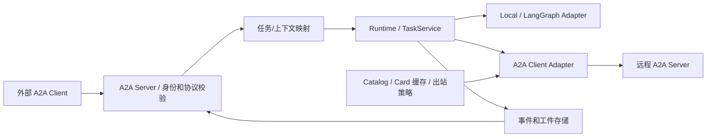
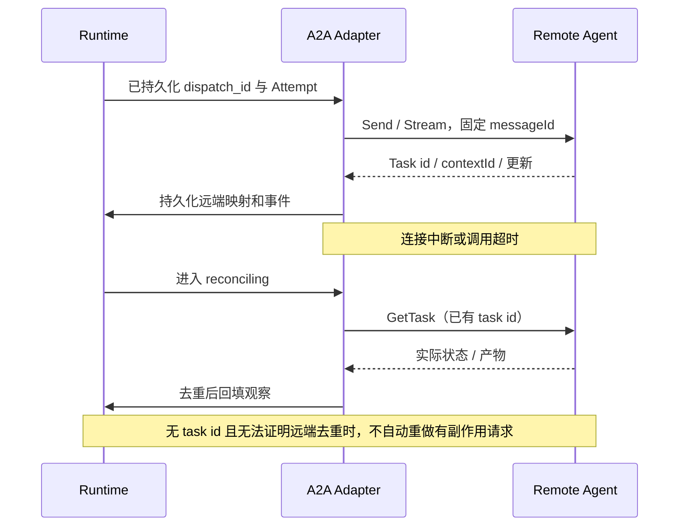

# 03 · A2A 通讯与协议适配

状态：拟建。核对日期：2026-11-12。以 [A2A 1.0.1 规范](https://a2a-protocol.org/v1.0.1/specification/)为设计基线，线协议使用 `1.0`；规范补丁号不发送为协议版本。实施时锁定支持该协议的 [Python SDK](https://github.com/a2aproject/a2a-python)具体版本及 hash，并运行互通测试；本次没有安装或验证 A2A SDK。

## 1. 通讯分工与边界

| 通道 | 适用对象 | 本平台设计 |
|---|---|---|
| 本地 Adapter | 可信且同部署的 Python Agent/子图 | 类型化调用；复用任务/事件合同，无需绕 HTTP 自调用 |
| A2A | 独立部署、跨框架或外部 Agent | 有 Agent 身份、任务状态和产物的服务间交互 |
| MCP | 工具、数据源和外部能力 | Agent 使用 MCP Adapter；工具结果进入当前 Attempt |
| 平台事件/队列 | 调度器与 Worker、运行事件 | 内部传输和恢复；不宣称是 A2A wire format |

A2A 和 MCP 的分工依据[官方对比](https://a2a-protocol.org/latest/topics/a2a-and-mcp/)。四种协作方式是平台策略，协议本身不会决定谁是 Supervisor 或如何形成 Swarm 共识。

## 2. 进出站结构



A2A Server 为本平台公布的逻辑 Agent 提供服务；本地定义通过统一运行内核实现其技能。一个对外 Agent 可以在内部运行整个 Workflow；对方只需要知道协议和业务合同，不需要看到内部图或提示词。

多 Agent 托管使用独立域或明确配置的 Card URL；不能假定在同一主机任意路径下的 Card 都是域根 well-known。Card 所选接口若声明 `tenant`，Adapter 按该接口准确发送它；它是远端路由值，不等同于本平台认证租户。

## 3. 协议表面和版本约束

第一版选择 HTTP+JSON binding；接口相对 Card 公布的服务根路径。以下名称依据 [1.0.1 的方法映射和 HTTP binding](https://a2a-protocol.org/v1.0.1/specification/#53-method-mapping-reference)。

| 能力 | HTTP+JSON | 平台处理 |
|---|---|---|
| Agent 发现 | `GET /.well-known/agent-card.json`（域根）或目录明确 URL | 读取身份、skills、supportedInterfaces 和认证声明 |
| 提交消息 | `POST /message:send` | 返回 Message 或 Task，分别映射 |
| 流式消息 | `POST /message:stream` | Task、状态和工件更新经 Adapter 转为平台事件 |
| 查询任务 | `GET /tasks/{id}` | 恢复、对账和状态轮询的基础 |
| 列任务 | `GET /tasks` | 按权限提供查询；不用于盲目恢复重复业务动作 |
| 取消 | `POST /tasks/{id}:cancel` | 返回观察结果，核实远端是否终止 |
| 订阅已有任务 | `POST /tasks/{id}:subscribe` | 断流后重新观察任务，平台自行去重 |

首版声明 streaming 能力，pushNotifications 设为 false；webhook 后置，只有实现和验证后才在 Card 宣告。订阅能力按协议和实际 SDK 验证，不能把任意 HTTP SSE 接口称为 A2A。

1.0 示例使用 `SendMessage` 等 JSON-RPC 方法名，HTTP 示例使用上表路径；不混用 0.3 的 `message/send`、`tasks/get`。1.0 的 Part 使用成员区分类型，示例不加旧版 `kind`。绑定和 Schema 以固定规范为准，教程可能包含旧示例；兼容 0.3 时采用独立适配器与测试，不自动降级。

## 4. Agent Card 与请求示例

Card 从发布定义生成，包含所需的名称、描述、Agent 版本、`supportedInterfaces`、capabilities、默认媒体模式、skills 和安全声明。仅宣告实际可用能力；Card 的 `version` 是 Agent 自身版本，不能代替协议版本或平台 revision。发现约定见[官方 Agent Discovery](https://a2a-protocol.org/latest/topics/agent-discovery/)。

HTTP 请求示例，`example.com` 为占位域；这里发起新交互，由服务端分配远端 context/task，不传平台 Run ID 冒充远端 ID：

```http
POST /message:send HTTP/1.1
Host: research.example.com
Authorization: Bearer <service-token>
A2A-Version: 1.0
Content-Type: application/a2a+json
```

```json
{
  "message": {
    "messageId": "msg-001",
    "role": "ROLE_USER",
    "parts": [{"text": "研究该主题，返回带来源引用的结构化报告。"}]
  },
  "configuration": {
    "acceptedOutputModes": ["application/json", "text/plain"]
  }
}
```

如需续答，使用远端返回的 `contextId` 和处于可续答状态的 `taskId`。简单 Message 返回可形成一次已完成的本地 Attempt，但必须通过预期输出合同；不得虚构远端 task_id。长期可查询/可恢复任务要求目标 Agent 实际支持 Task 模式；只有 Message 的 Agent 可以接入受限用途，不能承诺任务查询和取消。

## 5. ID 和状态映射

| 平台字段 | 远端字段 | 规则 |
|---|---|---|
| `run_id` | 无直接等价 | 一次业务目标可包含多个远端任务 |
| `conversation_id` | `contextId` | 经远端身份和本地租户限定建立映射，不全局共享 |
| `task_id / attempt_id` | Task `id`，消息中的 `taskId` | 保存映射和原始回执；一个本地 Task 的多个 Attempt 可有多个远端 Task |
| `dispatch_id` | `messageId` + 本地幂等记录 | 相同派发重发使用同一 ID；远端是否去重必须协商/验证 |
| `artifact_id` | 远端 `artifactId` | 记录生产者、媒体类型、hash、版本和获取授权 |

下面的 A2A 枚举是所选 1.0 binding 的 wire 值。任务终态不可重启；后续修改应建新任务并关联上下文，依据[官方任务生命周期](https://a2a-protocol.org/latest/topics/life-of-a-task/)。

| 远端状态 | 平台观察/动作 |
|---|---|
| `TASK_STATE_SUBMITTED` | remote_pending，保留提交事实并等待 |
| `TASK_STATE_WORKING` | running，持续观测截止时间和预算 |
| `TASK_STATE_INPUT_REQUIRED` | waiting_input，只向有权限的请求者索取信息 |
| `TASK_STATE_AUTH_REQUIRED` | waiting_auth，平台外认证流程；不让模型索取密钥文本 |
| `TASK_STATE_COMPLETED` | 远端执行完成；先校验输出和工件，再决定本地 Task 成败和产物验收 |
| `TASK_STATE_FAILED / REJECTED / CANCELED` | 对应失败、拒绝或取消观察，保留原因和副作用状态 |
| 未指定、未知、不可达 | remote_unknown / reconciling，不伪造远端终态 |

保留三个维度：`remote_status`、`local_execution_status`、`artifact_review_status`。例如远端 completed、输出不符合 Schema，则本地 Task 可以失败，但不能篡改远端 completed 的事实。

## 6. 流、超时、取消与重复请求



- **发送幂等**：官方规范允许使用 messageId 去重，但不是所有远端必然支持。平台入站实施持久 inbox 去重，键含认证主体、目标 Agent 和 messageId；重复且 body 不同返回冲突。出站若未约定幂等且提交结果未知，暂停自动重发，查询或进入人工对账。
- **事件去重**：平台为落库事件分配递增 sequence，UI 用 Last-Event-ID 补读平台日志；不假定远端 A2A 有跨重连可重放的序号。工件更新按远端 Artifact ID、chunk/append 语义组装；不能通过文本相同简单删除合法的重复块。无法确定组装结果时重新查询快照。
- **重试**：只对可安全重试的连接/限流等故障做退避和总预算限制；业务拒绝、认证失败、Schema 不匹配不盲重试。进程重启先读远端映射，不能只凭本地超时再提交。
- **取消**：平台先记录请求，再调用 CancelTask，后续查询确认；不支持或不可达就保留未知状态并停止进一步委派。父 Run 可标“逻辑已结束、仍有未确认远端动作”，不能显示全部停止。
- **输入等待**：waiting_input/waiting_auth 有期限，不持有 Worker 执行槽；用户回复必须绑定正确 tenant、Run 和远端 Task，并验证仍可续答。

## 7. 身份、上下文与远端产物

远程服务采用 TLS、服务身份和短期凭据；Card 的认证声明只说明要求，授权仍由目标服务核实。目标域、DNS 解析、重定向、Card URL、工件下载 URL 和后置 webhook 统一经过出站策略，防止绕过已批准边界。

发送上下文采用字段投影和引用：只发送完成子任务必要的信息，不传整段会话、原始凭据或不相关租户数据。远端模型文本、工具结果和工件均为非可信输入；只能转为候选产物或经过校验的意图。工件引用按媒体类型、大小、hash、租户和保留策略校验，不自动访问任意文件 URI。

平台内部的 deadline、预算、父 Task 和 trace 可以通过双方明确约定的 metadata/extension 传递；未定义扩展时只在本地保存，不往标准字段添加伪规范要求。远端 usage 不可见时记录 unknown，不把它写成 0；平台不能强制外部 Agent 在断连后停止花费。

## 8. 协议验收

使用独立进程、锁定版本的官方 SDK 参考 Agent，测试双向发现和调用。覆盖 Message-only、Task、流式工件、查询、输入续答、认证等待、取消、断流重连、重启恢复、重复消息、错误版本和未知字段。测试 0.3 Agent 时必须验证“明确拒绝”或“指定兼容适配器”，禁止静默混用。

这些是后续实施门槛；本次只有规范阅读和设计，没有 A2A 运行互通证据。
