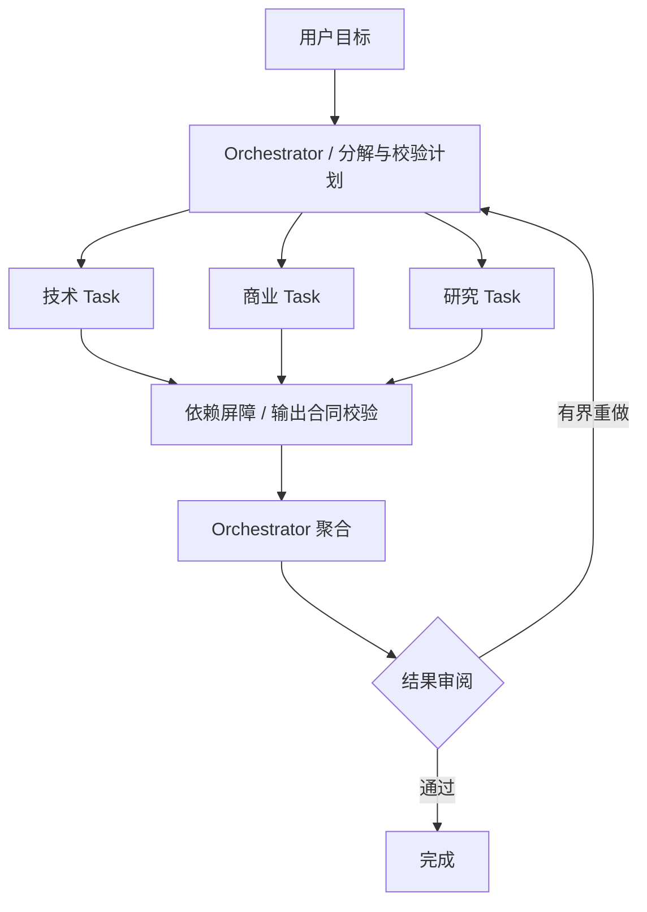
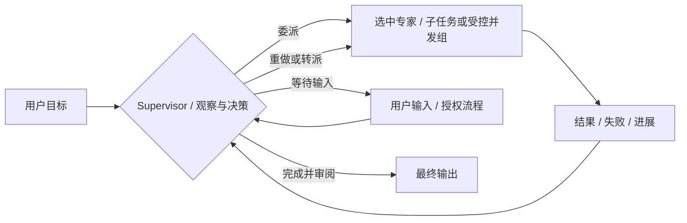
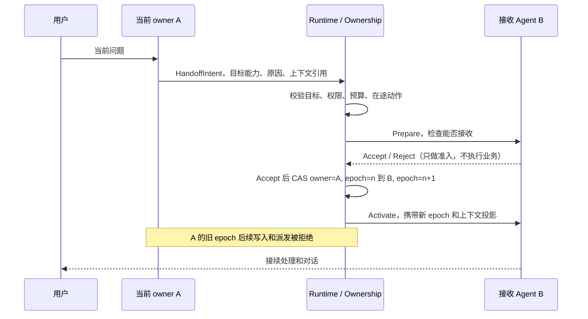
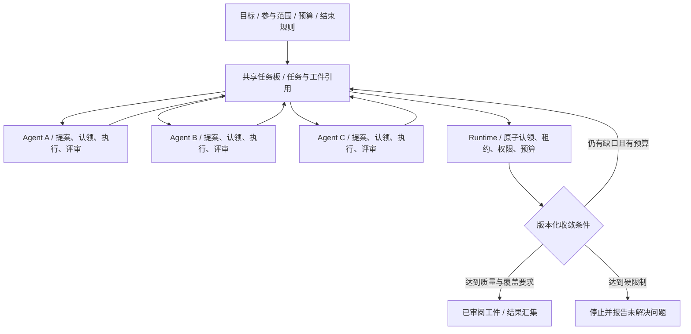

# 04 · 四种多智能体协作方式

状态：拟建。四种模式共用 Registry、Task/Attempt、A2A、本地 Adapter、预算、事件和产物合同。区别主要在**谁决定下一步、任务怎样拆分、控制权如何移动、什么时候结束**。

## 1. 语义与选择

| 模式 | 业务决策权 | 工作分配 | 完成后控制流 | 适合当前仓库的例子 |
|---|---|---|---|---|
| Orchestrator-worker | Orchestrator | 先拆子任务，再按依赖分派，可并行 | Worker 返回 Orchestrator 聚合 | 将会议的技术/商业/研究分析拆开后汇总 |
| Supervisor | Supervisor | 每轮观察进展，再决定调用、审阅、重做或结束 | 每步回到 Supervisor | 主持人根据专家结果补充问题或换专家 |
| Handoff | 当前会话 owner，允许转交 | 当前 Agent 请求把后续交互交给另一 Agent | 接收方成为 owner，不自动回原 Agent | 需求分析师把后续技术对话交给技术专家 |
| Swarm | 多个参与 Agent 在规则内自主决策 | 对共享任务提出工作、认领、协商和提交 | 多个 Agent 持续响应任务/产物变化 | 多领域专家自主补缺、交叉审阅和综合建议 |

Orchestrator-worker 可以按显式策略重新规划，但以子任务图和结果聚合为主。Supervisor 以“观察 → 决策 → 调用 → 再观察”的持续控制为主。Handoff 是转移后续处理权，不只是把 Agent 当工具调用。Swarm 不能只是把所有 Agent `gather` 一次，必须有自主参与和共享协作状态。

## 2. Orchestrator-worker



流程：Orchestrator 返回带稳定任务键、能力需求、依赖、输入引用和输出 Schema 的计划；Runtime 检查任务数上限、依赖无环、资源和授权；满足依赖后派发。Worker 只得到分配的输入和上下文投影，结果以 Artifact 返回。Join 明确等待全部、quorum 或可选任务失败后的降级规则。

控制权始终属于 Orchestrator 的 Pattern 实例，Worker 不接管用户会话；Worker 可以提出新工作建议，但不能自行扩张 DAG。计划修订记录 `plan_revision`，已完成节点不重复执行，受影响的下游显式失效；有副作用的历史节点必须先对账再决定补偿或重做。

失败处理：超时按 Task 策略重试或产生失败输入；必需节点失败则停止依赖它的节点，可选节点允许聚合时标注缺失。输出满足合同与审阅后才能结束，不能以所有 Future 返回作为成功。

## 3. Supervisor



Supervisor 每轮只接收运行状态、产物摘要、质量缺口和剩余预算，返回结构化决策：`delegate`、`review`、`revise`、`wait_input` 或 `finish`。不依赖从自然语言中匹配“继续/结束”。单轮可委派一个专家或一个明确的并发组，但结果必须回到 Supervisor。

防止循环：设置 `max_decisions`、`max_revisions_per_task`、相同目标/输入重复决策检测、deadline 和费用上限；无进展达到阈值时输出未解决问题并结束或转人工，不强行产生成功。监督者故障通过其持久决策记录恢复；重放先查对应派发是否已经执行。

与当前会议图的迁移：把分析师、技术/商业/研究专家和总结者作为能力注册，主持人的判断转为受 Schema 约束的决策。保留原图作为行为基线；新增追问应作为显式 Task/决策记录，不能仅假设 `ask_question` 已在旧图中运行。

## 4. Handoff



owner 是指定会话处理域的业务控制权，转交时父 Run ID 和会话关联可以保留；A2A 远端任务 ID 仍由对方生成。Handoff 不要求传递全部历史，而是携带目标、已完成工作、约束、未决问题、产物引用、必要的用户上下文和可见范围。

状态：`proposed → preparing → accepted → committed → active`；也可以 `rejected/expired`。每次转交有唯一 `handoff_id`，prepare、commit、activate 均幂等。Prepare 期间 A 不再发起新的冲突动作；B 在 commit 前只能校验，不得开始业务执行。

关键故障语义：

- B 拒绝或 prepare 超时：owner 仍是 A，记录失败后继续或改选。
- 提交后通知 B 丢失：事务 outbox 重发 Activate；恢复时以数据库 owner/epoch 为准，A 不恢复旧权力。
- A 在途工具仍运行：等待其完成或明确取消/对账后才能转交冲突写域；epoch 只能保护经过平台的写入，不能撤回已经发往外部的操作。
- 提交后 B 崩溃：查询原执行与副作用，恢复同一次转交或进行新的有记录转交；不让 A 和 B 同时重新执行。

设置允许转交边、`max_hops`、重复路径检测和总预算。归还 A 也是一次新 Handoff；子任务返回值本身不触发控制权回退。外部 A2A 不原生保证平台 owner 的原子变更，准入和 commit 是本平台的编排行为，远程 Adapter 在 commit 后才发送真正的业务任务。

## 5. Swarm

本方案采用有边界的共享任务板 Swarm：参与者在相同目标和规则下独立判断工作机会，提出子任务、认领可做的任务、提交产物和评审。基础设施协调器保证一致性和硬限制，不充当每一步的业务 Supervisor。



### 5.1 去重、写入与通信

共享状态不是可随意修改的 Python dict。Agent 提交 `ProposeTask / ClaimTask / SubmitArtifact / ReviewArtifact / RequestHelp` 意图，由 Runtime 校验后事务写入。标准事件可通过平台事件通道或 A2A 发送；消息不直接授予任务所有权。

同一逻辑任务键在一个 Run 中唯一，例如 `(run_id, task_key)`；相似提案由确定规则或受控审阅决定合并，不能只靠 LLM 自称“不是重复任务”。认领使用 CAS 和租约，单个 Task 同时只有一个有效执行 owner。需要冗余验证时创建明确的多个独立 Task，而非允许双重领取。

Agent 产物写入独立命名空间并保持不可变；共享汇总由固定 reducer 或有记录的合并步骤更新，基于 `expected_version` 检测并发冲突。合并冲突重新读取后解决，不采用最后写入覆盖。一个 Agent 的结论在未审阅前只能作为候选。

### 5.2 收敛、仲裁与退出

参与 Agent 的“我认为完成”只是一条提议。Workflow 定义可测试的完成条件，例如：必需主题都有符合 Schema 的产物、每项至少有一名其他参与者审阅、未决阻断为零、没有活动或待对账任务、最终汇集通过合同校验。自评不可算作独立审阅；投票数不等于事实正确，冲突应保留原始证据并按指定规则仲裁。

硬限制包括任务总数、每 Agent 并发、提案数、迭代数、空转轮数、token/费用预算和 deadline。达到限制先停止新提案和领取，再排空/取消并记录未知外部动作，输出 partial/failed 和剩余问题。通过预算或截止时间停止不叫达成共识。

第一版只允许已发布、获准且有合同的 Agent 加入，参与者变化追加到 Run manifest。禁用/离线时停止新认领，持有任务进入对账；健康恢复也不能跳过对旧租约的检查。

## 6. 统一配置示例

以下是自有 Workflow Manifest 的结构示意，各字段在第 0 阶段形成 JSON Schema；不是可直接执行的现有配置。每个参与者引用都需解析到明确 revision。

```yaml
apiVersion: platform.ai/v1alpha1
kind: WorkflowDefinition
metadata:
  workflow_id: expert-discussion
  revision: 1
spec:
  pattern: supervisor
  participants:
    supervisor: moderator@1
    specialists: [tech-expert@1, business-expert@1, research-expert@3]
  limits:
    max_tasks: 12
    max_decisions: 8
    max_parallel_tasks: 3
    deadline_seconds: 600
  context_policy_ref: discussion-projections@1
  output_contract_ref: schemas/discussion-report.output.v1.json
  completion_policy_ref: required-sections-reviewed@1
```

四种模式分别补充配置：

| 模式值 | 专属配置 | 发布前校验 |
|---|---|---|
| `orchestrator_worker` | orchestrator、worker capability selectors、DAG 限制、join policy、聚合器 | 依赖无环，必需输出完整，计划大小有限 |
| `supervisor` | supervisor、可委派专家、decision/revision limits、决策 Schema | 决策动作枚举和目标白名单，有失败/等待/结束分支 |
| `handoff` | 初始 owner、allowed_edges、max_hops、context projections、prepare timeout | 初始唯一 owner，所有转交边有授权和可接收目标 |
| `swarm` | 参与者/选择器、proposal/claim policy、reducer、review/quorum、idle limit | 唯一任务键、原子认领、合并冲突策略、可计算终止条件 |

不把四种专属字段全部装进一个任意字典；Schema 按 `pattern` 使用 discriminated union，错误组合在发布前拒绝。

## 7. 模式组合与共同验收

可以让 Supervisor 委派一个 Orchestrator-worker 子流程，或让 Handoff 后的新 owner 发起有边界的 Swarm。每个子流程是独立子 Task/子 Run，拥有局部 Pattern owner，但受父级权限、deadline 和剩余预算约束；父级等待，不能同时重做子域任务。设置最大嵌套深度，禁止多个策略同时改变同一 Task 的 owner。

四种模式使用相同输入集、业务合同、模型/工具 profile 和预算评测，分别记录结果质量、成功率、延迟、tokens、转交/空转次数及故障恢复。先与单 Agent、固定图基线比较；只有协作带来可复现的收益时，才为业务默认启用。详细验收见[项目规划](06-project-roadmap.md)。
