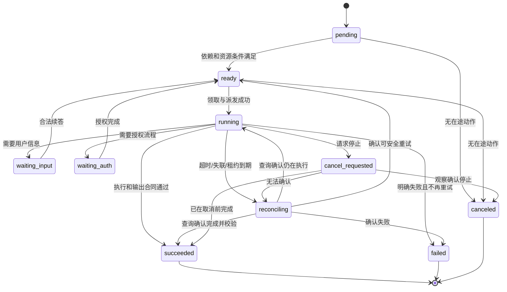
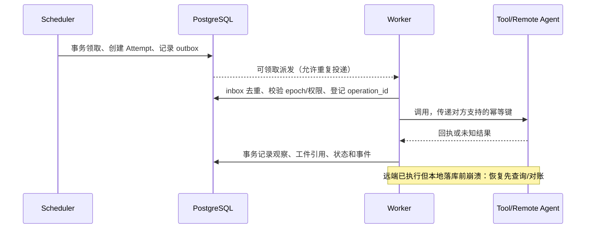

# 05 · 运行状态、可靠性与治理

状态：拟建。这些能力由共享内核实现，不在四种 Pattern 中各做一套。数据库、租约、重试和 checkpoint 都不能单独证明外部操作只执行一次。

## 1. 执行与验收分开建模

Run 表达业务目标，Task 表达工作单元，Attempt 表达一次执行尝试。Workflow 决定终止和质量规则，Runtime 执行合法状态迁移。核心 Task 状态为：

图展示主路径；每个非终态都需定义合法的取消、拒绝和截止时间处理。`rejected` 用于准入/合同/权限拒绝；当前 Attempt 的重试先落失败事实，再创建新 Attempt。等待输入或认证时保存续答信息并释放 Worker 槽，恢复原远端 Task/本地图 checkpoint；不能把 ready 当作从头重做业务的许可。

Attempt 另外保存 `observed_execution`、`side_effect_state`（none/pending/confirmed/unknown）和原始 provider 回执。Artifact 使用 candidate/accepted/rework 状态。Task succeeded 表示执行和输出合同通过；业务验收是否必须 accepted 由 Workflow 的完成规则决定。

Run 可具有 queued/running/waiting/reconciling 等非终态，以及 succeeded/partial/failed/canceled 终态。只有必需输出和完成规则通过才 succeeded。允许 partial 的业务必须明确哪些缺失可以接受。Run 逻辑结束后仍有不可确认的外部动作时，额外保留 `outstanding_effects=unknown` 和未清理 Attempt，界面必须显示，不能宣称物理执行已全部结束。

## 2. 状态所有权与数据库设计

| 数据 | 最小设计要求 |
|---|---|
| agents / agent_revisions / config_revisions | tenant + stable ID；revision 唯一且发布后不可变 |
| deployments / agent_instances | desired/observed revision、心跳、健康、实例租约和容量 |
| workflow_revisions / runs | 固定版本、有效 manifest、配置 hash、权限/预算与终止策略 |
| tasks / attempts | 父子关系、依赖、状态版本、当前 attempt、owner epoch 和执行租约 |
| run_events | `(run_id, sequence)` 唯一，事件与相关状态在同一事务保存 |
| outbox / inbox | 待投递事件、重试、消费去重、payload hash；业务状态和 outbox 同事务 |
| artifacts / reviews | producer attempt、Schema、URI/hash、版本关系和审阅身份 |
| handoffs / swarm_claims | 转交状态、期望 owner/epoch、任务唯一键和认领租约 |
| operation_ledger / remote_tasks | 业务幂等键、副作用回执、远端 endpoint/context/task 和协议版本 |

第一版使用关系表 + 必要 JSONB，不实施完整 Event Sourcing。Runtime 是 Task/Attempt 状态唯一写入者；API 提交命令，Worker 提交观察，Pattern 提交意图。数据库约束、事务和 CAS 防止覆盖，不能只靠 Python 锁。

调度器用 `FOR UPDATE SKIP LOCKED` 领取 ready 任务，在事务中预留容量/预算并写入 attempt/lease。持有租约的 Worker 使用 owner_epoch/fencing token 提交；旧租约写入被拒绝。多个调度器可以并行领取，但同一任务只有一个有效 owner。数据库队列的通知只负责唤醒，任务表才是待执行事实。

## 3. 可靠派发和幂等

内部传输按 at-least-once 设计，平台去重作用于消息/派发；业务动作使用稳定 `operation_id`，重试仍沿用同一业务意图键。幂等键应含租户、目标资源与业务动作，不能仅靠每次新生成的 run_id。

目标系统支持原子幂等时记录并重用其回执；不支持时通过查询、业务唯一约束或人工对账控制风险。平台无法普遍保证跨数据库和外部服务的 exactly-once。fencing token 保护受控写入，并不能阻止已取得凭据的旧进程访问不识别 fencing 的外部服务。

模型生成可以有界重试，工具写操作不能随模型整轮重放。把计划/模型调用/有副作用工具步骤拆成带稳定 ID 的可恢复单元。补偿是新的可审计业务动作，不是任意执行逆向脚本；没有可靠补偿时保留状态并升级处理。

## 4. Checkpoint、恢复与版本

平台状态保存“目标、谁有权做、做到了哪一步、有哪些回执”；LangGraph checkpoint 保存子图计算状态，两者不是两套并行调度器。checkpoint 引用写入 Attempt；平台确认需要恢复后，Adapter 使用原 thread/checkpoint namespace 继续。原图的 `compile()` 不带持久 saver，不具备此能力，详见[当前架构](../current-architecture.md)。框架 persistence 的范围参见[官方说明](https://docs.langchain.com/oss/python/langgraph/persistence)。

恢复顺序：加载固定 manifest → 校验当前授权 → 查询原 Worker/远端执行 → 对账工具副作用 → 校验 checkpoint 兼容 → 续行或创建可安全重试的 Attempt。旧版本制品需按保留策略可获得；新代码不能无校验地读取旧 checkpoint。无法恢复时明确 failed/needs_operator，不静默切换到当前 latest 重跑。

## 5. 取消、超时和预算

取消按 Run → 子 Task → Attempt → 工具/远端传播。先停止新增派发，再请求在途停止，最后核实停止结果。对本地代码工具使用可回收进程组或沙箱生命周期；只取消一个 asyncio Task 不足以证明子进程停止。到达取消期限后仍不明的动作进入 reconciling。

总 deadline 比单次 timeout 优先，子任务预算从父级原子预留；并行任务不得分别拿到完整父预算。预算包括任务数、活跃并发、模型输入/输出上限、工具次数、费用额度与远端调用上限；完成后核销，失败和重试也计费。未知远端消耗保留预留和 unknown，不释放成“免费额度”。

模型侧费用硬封顶依赖供应商可控参数、预留估算和回执；外部 Agent 若不能报告/接受预算，只能用调用次数和超时限制本地委派，并明确其实际费用未知。精确币种和价格版本由 ModelProfile 固定，不能从 token 数直接宣称账单金额。

## 6. 上下文、隔离与配置安全

上下文分为用户会话视图、Run 共享事实、Task 输入和 Agent 私有工作区；每次派发按 projection policy 投影。共享事实必须有来源、版本和可见范围；模型生成的建议不能直接覆盖已经核验的事实。长期记忆是独立服务能力，必须有写入准入、查询授权和保留/删除策略。

每次数据库查询、对象访问、事件订阅和工具调用都基于服务端认证租户。开发阶段可使用显式 tenant key；部署环境增加行级权限或等价强制隔离，并做越权测试。文件/代码工具使用独立工作目录、资源限制和出站允许范围，不能沿用示例中“主机子进程即安全沙箱”的假设。

注册只能引用允许制品；A2A、MCP、模型 endpoint 和工件下载均受统一出站策略。工具权限绑定业务操作，模型不能通过 prompt 或 metadata 扩权。密钥引用按租户和 Worker 身份解析并脱敏，审计记录操作者、目标、版本、原因和回执。应用具体高风险动作是否需要人工确认由业务策略定义，不要求每个只读步骤都确认。

## 7. 可观测性

每次 Run/Task/Attempt/模型/工具/A2A 调用有可关联 trace；持久事件包含 decision summary、actor、revision、duration、error class、token/usage 来源和 artifact refs。记录必要的决策摘要与可观察行为，不要求保存模型隐含推理。敏感输入按保留策略脱敏，遥测后端不可获得未经授权的全量上下文。

基础指标：排队时间、活跃/等待/对账任务、成功/失败/partial、重试、取消确认延迟、A2A 断连/未知结果、实例过期、每模式 task/hop/空转量、token 和可见费用。按环境建立告警阈值；“health 接口正常”不等于端到端任务正常。

性能目标在第 0 阶段固定，至少分开测不含模型的管理/调度开销、模型等待和业务端到端延迟。四种协作方式分别报告质量/成本，禁止用总调用次数当作业务收益。
