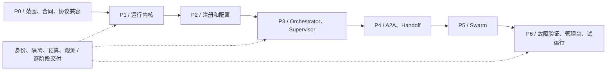

# 06 · 项目规划、迁移与验收

状态：拟建实施计划。本次只完成架构梳理与方案；以下目录、服务、测试和里程碑都未创建或执行。

## 1. 工程组织

建议继续使用当前 monorepo，增加独立平台目录，保留原样例作为迁移输入；不把所有 `src` 包直接放在同一个 Python path 下。第一阶段先统一 package 命名和依赖锁，再迁移行为。

```text
ai-architect/
├── docs/
│   ├── current-architecture.md
│   └── ai-archtect/                 # 本方案
├── platform/                       # 拟新增，目录名不作为 Python 包名
│   ├── pyproject.toml              # 构建/依赖/开发工具；生成并提交单一锁文件
│   ├── src/agent_platform/
│   │   ├── api/                    # 管理、运行、事件入口
│   │   ├── contracts/              # 类型、Schema、错误、协议版本
│   │   ├── registry/               # 定义/实例/发现
│   │   ├── configuration/          # revision/发布/有效快照
│   │   ├── collaboration/
│   │   │   ├── base.py
│   │   │   ├── orchestrator_worker/
│   │   │   ├── supervisor/
│   │   │   ├── handoff/
│   │   │   └── swarm/
│   │   ├── runtime/                # Run/Task/Attempt/owner/预算/恢复
│   │   ├── context/                # 投影、checkpoint 引用和工件
│   │   ├── adapters/               # 本地、LangGraph、A2A
│   │   ├── resources/              # 模型、MCP、RAG、沙箱
│   │   └── infrastructure/         # 数据库、队列、存储、身份、遥测
│   ├── migrations/                # 数据库演进
│   ├── tests/{unit,contract,integration,e2e,fault}/
│   └── examples/{discussion,travel}/
├── deployments/                    # API/Worker 配置、开发 compose、观测
├── sdk/python/                     # 后置；只依赖公共合同
├── console/                        # 后置；前后端分离管理台
└── 原有子项目                       # 保留独立环境；逐一通过 Adapter 迁移
```

Python 包用 `agent_platform`，避免与标准库 `platform` 同名。依赖方向从 API/Adapter/Infrastructure 指向应用/领域契约，Pattern 只依赖 contracts 和运行视图；不能让 Pattern import 数据库驱动或某厂商 SDK。模块化单体先维持一个发布单元，API/Worker 按启动角色部署。

## 2. 实施阶段与退出条件

下表估算以 2 名熟悉 Python/Agent 的工程师、共享 QA/运维支持为前提，约 8–12 周形成可验收试运行候选。是工作量规划，不是已验证工期；第 0 阶段根据容量、集成和业务要求重新排期。表内时间可能因依赖和故障验证交叠，不能简单当固定承诺。

| 阶段 | 建议时间 | 核心交付 | 退出条件与依赖 |
|---|---|---|---|
| P0 范围与合同 | 0.5–1 周 | 业务样例、单 Agent/旧图基线、公共 Schema、模式定义、SLO/预算/权限边界、依赖兼容矩阵 | 固定首版用例/部署目标；A2A SDK 与协议版本可匹配；定义失败和未知结果语义 |
| P1 最小运行内核 | 1.5–2 周 | FastAPI Run API、PostgreSQL、Task/Attempt、事件、DB 队列、本地 Adapter、工件、预算/取消骨架 | 单 Agent 跨进程运行、查询、取消、重启对账和幂等可验证；P0 完成 |
| P2 注册与配置 | 1–1.5 周 | Catalog、版本发布、Discovery、实例租约、配置快照、排空与审计 | 运行中注册新实例可发现；并发发布冲突正确；旧 Run 固定旧配置；依赖 P1 |
| P3 两种集中协作 | 1.5–2 周 | Orchestrator-worker、Supervisor、会议迁移、旅行并行样例 | DAG/并行聚合和循环监督分别通过；输出失败不会被当完成；依赖 P1/P2 |
| P4 A2A 与 Handoff | 1.5–2 周 | A2A Server/Client、Card、Task 映射、流/查询/取消、原子 Handoff | 与独立参考 Agent 互通；断流、未知提交、转交重复与崩溃恢复通过；依赖 P2/P3 |
| P5 有边界 Swarm | 1–1.5 周 | 任务板、提案、唯一认领、冲突合并、交叉审阅、收敛与硬限制 | 重复提案/认领不重复副作用；空转与预算停止可预测；依赖 P1/P2/P4 |
| P6 整体验证与试运行 | 1–2 周 | 管理台最小闭环、观测、故障注入、部署/回滚、业务评测报告 | 四种模式和 A2A 端到端通过，业务方核对样例结果；生产发布另按实际环境验收 |

身份、租户隔离、秘密引用、预算和基础观测从 P1 接入，每阶段都执行相关验收；P6 负责综合验证，不能到最后才补安全。A2A 的绑定/SDK 小实验在 P0 固定版本，完整适配在 P4 实施。

## 3. 任务依赖图



## 4. 现有模块如何迁移

| 现有模块 | 复用内容 | 平台迁移方式 | 先处理的问题 |
|---|---|---|---|
| `server` | FastAPI 入口、配置装配经验 | 新增独立版本 API；旧 LangServe 链可做 Legacy Adapter | 启动注册不是管理 API；不能把 ROUTE_CONFIGS 作为运行中版本目录 |
| `graph_discussion` | 角色提示、ConferenceState、会议流程 | 先整图 Adapter 保持基线，再把专家和主持人拆为注册能力/策略 | 专家顺序执行；固定专家表；未接入 ask_question；模拟工具需标注或替换 |
| `agent_muti_discussion` | 会议业务和共识输出 | 作为另一行为参考；不再复制第二套 SessionManager | 对象内存历史、多轮停止边界和文本解析需要合同验证 |
| `agent_muti` | Agent 能力抽象、插件、旅行领域、迭代思路 | 能力转 Definition，迭代转 Supervisor，任务结果转 Artifact | 主路径不走 MessageBus；execution_sequence 未驱动 Action 依赖；不能把当前字典/队列当分布式目录/消息系统 |
| `manus` | 规划/路由/执行/检查、工具和 LLMManager 概念 | 子图 Adapter → 可验证 Task 节点；按需迁移专用 Agent | 失败结果仍 completed；全局 AgentPool；配置层级需契约测试；空 memory 文件不复用为实现 |
| `mcp_client_manager` | 工具发现、tool schema 和 call_tool | MCP Resource Adapter，统一错误和权限 | 服务注册内存化、失败仅打印；入口 cleanup 调用未提供的 getMCPClient，迁移前验证资源释放 |
| `agentmcp`、MCP 服务 | MCP 协议端点与工具 | 注册为工具绑定，单独锁定 SDK/transport | 保留实际 SSE 兼容测试；数学表达式和代码工具需安全实现/沙箱 |
| `webui-chatbot` | 交互样例和多模态体验 | 后置 Console/Chat 通过平台 API；独立页面逐步迁移 | 业务/密钥/模型调用和 UI 混合，先拆服务契约 |
| RAG / lib_* | 文档索引、请求和打包经验 | RAG、ModelGateway、公共 SDK 的局部输入 | 不整体搬入互相冲突依赖；修正包导入并证明实际使用 |

上述是迁移前静态观察，不是本次修复清单。保留原子项目行为，平台迁移验证通过后再决定停用旧入口。不要直接让两个执行入口同时消费同一业务队列或共享有副作用写目录。

## 5. 验收矩阵

| 编号 | 验证场景 | 通过条件 | 证据类型 |
|---|---|---|---|
| REG-01 | 服务运行中注册、启停 Agent | 无需重启 API，新调用发现正确实例；不改变已固定任务 | API/DB/实例回读 |
| CFG-01 | 并发发布、灰度和回滚 | 一次 CAS 成功，一次冲突；新旧 Run 配置 hash 可追溯 | 发布记录与 Run manifest |
| LEASE-01 | Worker/Agent 心跳失效 | 停止新派发，恢复前对账；无效 epoch 提交被拒绝 | 故障注入、状态和副作用记录 |
| OW-01 | 三个独立任务 + 一个依赖汇总 | 可独立并行、依赖成立后执行、必需失败分支正确 | Task 图、时序和工件 |
| SUP-01 | 监督者发现输出缺口后重做 | 结构化决策回到监督者，达到修订上限可停止 | 决策事件、产物版本 |
| HO-01 | B 拒收、提交后崩溃、重复 Activate | 原子转移，一个有效 owner；旧 owner 的派发和写入失效 | CAS/epoch、跨进程恢复 |
| SW-01 | 两 Agent 同时认领/重复提案 | 一个逻辑任务只一次有效认领；冲突不覆盖产物 | 竞争测试和 operation ledger |
| SW-02 | 无进展、互相争议、预算耗尽 | 收敛或按规则 partial/failed，剩余问题可见 | 有界事件序列、费用/任务数 |
| A2A-01 | 双向跨进程发现、消息、Task、SSE | 独立 SDK 对端与平台相互调用，字段/版本正确 | 真实协议请求/回执（脱敏） |
| A2A-02 | 已执行后断连、无 task id 的未知提交 | 先查/对账；无幂等保证时不自动重复写操作 | 故障点、远端实际副作用 |
| RUN-01 | 调度器和 Worker 在关键点崩溃 | 重启后状态可解释、无遗失任务；未知结果保留 | 故障注入、DB/外部对账 |
| CANCEL-01 | 子进程/远端取消超时 | 可控进程确认停止；不可确认远端明确 unknown | 进程/远端查询，非仅本地标志 |
| ISO-01 | 跨租户查 Agent/Run/事件/对象/工具 | 每条访问被拒绝或只返回授权范围，日志无秘密 | 授权和出站负例测试 |
| QUALITY-01 | 同预算的单 Agent、旧图、四模式 | 质量、成本、延迟和未解决项可复核；无预设必胜结论 | 固定用例集和评测报告 |

先用 deterministic fake Agent 做状态机、并发和故障验证，再用独立真实 A2A 对端测协议，最后对获准模型/工具做业务评测。静态检查或 mock 通过不替代真实互通、模型效果或部署验收。

## 6. 风险、取舍与回滚

| 风险 | 控制方法 | 回退路径 |
|---|---|---|
| 平台范围过大 | P1 单 Agent、P3 两种模式先交付；管理台和基础设施扩张后置 | 使用单 Agent/固定图工作流 |
| A2A SDK/规范不匹配 | P0 锁定版本并做最小互通；协议对象不散落业务代码 | 暂限本地 Adapter，远程能力明确不可用 |
| 多套调度与重复副作用 | 每个 Task 一个 Runtime owner；原业务入口隔离，稳定 operation_id | 停止新派发，按回执对账后恢复 |
| 旧依赖冲突 | 每项目独立环境，新增平台锁文件；通过 Adapter 迁移 | 保留独立示例，不合并运行环境 |
| Swarm 不收敛或费用放大 | 原子领取、明确质量门槛、总预算/提案/空转限制 | 在同输入下改用 Supervisor 或固定 DAG，新 Run 记录模式改变 |
| 配置或 checkpoint 不兼容 | 不可变版本、旧制品保留、显式迁移 | 发布指针回退；已有 Run 沿原版本或进入明确失败 |

发布采用测试租户 → 少量新 Run → 扩大范围。数据库变更采用兼容新增、回填、切换和后续清理；回滚前检查旧版本能否读取新数据。禁用模式/Agent 时先排空并核对在途动作，不能单纯回滚代码就宣称任务已停止。

## 7. 开发协作边界

建议由平台/后端负责人维护公共契约、运行内核、注册/配置及 A2A；Agent/算法负责人维护四种模式、提示词迁移、上下文和质量评测；前端在 API 稳定后接入；QA 对故障、互通和模式行为独立验收；运维验证身份、存储、观测与恢复。

这是后续团队职责规划，不代表当前已派发任务。每阶段以已固定版本的代码、合同、测试结果和实际回执交接；设计评审通过、代码完成、集成通过、试运行验收和经营收益分别记录。
