# 多智能体运行平台技术方案

版本：设计草案 v1.0 · 日期：2026-11-12 · 代码基线：`5e8a52d47357a10767821ebeee8200a44bc3b085`。

本文档目录按需求保留拼写 `ai-archtect`。这里的模块、接口、配置和指标均为**拟建方案**；当前实现以[源码架构说明](../current-architecture.md)为准。本次交付设计文档，不实施平台服务。

## 1. 推荐路线

从现有 Python、FastAPI、LangGraph 和 MCP 代码演进，建设一个**控制面与执行面分离、共享运行内核、协作模式可插拔**的平台。第一阶段采用模块化单体代码结构，API 与 Worker 分进程部署；通过本地适配器接入现有 Agent，通过 A2A 适配器接入远程 Agent。暂不把每个角色拆成微服务。

平台对外提供 Agent 管理和任务运行 API，对内统一 Run、Task、Attempt、事件、上下文、产物和预算。Orchestrator-worker、Supervisor、Handoff、Swarm 是不同的决策/协作策略，共用执行、取消、恢复和权限机制。

A2A 负责跨 Agent 系统的任务通讯；MCP 继续负责 Agent 调用工具。A2A 不替平台提供调度、业务幂等、配置中心或自动建立信任；协议和工具的分工依据[官方说明](https://a2a-protocol.org/latest/topics/a2a-and-mcp/)。

## 2. 阅读顺序

| 文档 | 需要解决的问题 |
|---|---|
| [01 分层架构](01-platform-architecture.md) | 分几层、模块边界、部署单元、技术取舍与公共对象 |
| [02 动态注册与配置](02-agent-registry-and-configuration.md) | Agent 如何加入、发现、更新、下线，配置如何发布和生效 |
| [03 A2A 通讯](03-a2a-protocol.md) | 协议版本、Card、接口、ID/状态映射、流式传输和失败语义 |
| [04 四种协作模式](04-collaboration-patterns.md) | 决策者、任务归属、上下文、停止条件与模式组合 |
| [05 运行状态与可靠性](05-runtime-and-reliability.md) | 持久化、并发、幂等、取消、恢复、隔离与观测 |
| [06 项目规划](06-project-roadmap.md) | 目录结构、迁移步骤、任务依赖、阶段交付和验收 |
| [交付检查](validation.md) | 本次文档检查结果与尚未运行的验证 |

## 3. 目标架构总览

[PNG](diagrams/platform-architecture.png) · [Mermaid 源文件](diagrams/platform-architecture.mmd)

## 4. 需求与交付对应

| 用户需求 | 设计落点 | 后续实施的关键验收 |
|---|---|---|
| 阅读代码并画当前架构 | [当前架构](../current-architecture.md)和[源码指纹](source-snapshot.json) | 每条主要调用关系可回到源码；独立示例不伪装为已集成 |
| 多智能体平台分层 | [01](01-platform-architecture.md) | 层间经契约调用，策略不直接访问基础设施 |
| 项目规划 | [06](06-project-roadmap.md) | 每阶段有依赖、交付物、退出条件和回滚范围 |
| 动态注册和配置 | [02](02-agent-registry-and-configuration.md) | 运行中注册可被发现，旧 Run 不受新 revision 覆盖 |
| A2A | [03](03-a2a-protocol.md) | 与独立官方 SDK 参考 Agent 跨进程互通、查询、取消和恢复 |
| Orchestrator-worker | [04 §2](04-collaboration-patterns.md#2-orchestrator-worker) | 分解、并行/依赖执行、聚合及失败分支 |
| Supervisor | [04 §3](04-collaboration-patterns.md#3-supervisor) | 每轮监督决策、重做/转派、预算停止 |
| Handoff | [04 §4](04-collaboration-patterns.md#4-handoff) | 转交前后仅一个有效 owner，拒收可恢复 |
| Swarm | [04 §5](04-collaboration-patterns.md#5-swarm) | 多 Agent 自主提案/认领，避免重复执行，具备收敛和硬停止 |

## 5. 第一版边界与待定输入

默认面向可信团队内部使用，支持多个租户的数据和权限分区、同平台本地 Agent 与获准的远程 Agent。运行目标是可追踪、可取消、可恢复的业务任务。首个迁移样例选择现有会议讨论流程，再使用旅行规划验证动态选人与并行工作。

吞吐、并发租户、模型供应商、部署环境、成本上限和业务验收集尚未给定。规划中的容量和时间为估算，不是实测或承诺；在第 0 阶段固定这些输入。先交付可验证的小闭环，再决定消息中间件、容器编排和独立服务的扩展规模。

## 6. 关键架构决定

| 决定 | 理由与代价 | 重新评估触发条件 |
|---|---|---|
| 共享内核 + 四个策略模块 | 避免四套状态和恢复实现；需要稳定的策略契约 | 某模式出现无法表达的控制语义时扩展契约 |
| 平台 Run/Task 是控制事实源 | 现有流程可逐步迁移；需要明确框架 checkpoint 的从属关系 | 引入外部工作流引擎时显式迁移 owner |
| LangGraph 是执行适配器和流程工具 | 复用已有经验；业务模型不绑定框架内部对象 | 测试发现恢复、版本或吞吐不能满足目标 |
| PostgreSQL 起步，任务队列先用数据库 | 少引入基础设施，事务边界清楚；需自行实现领取/重试 | 压测证实队列争用或事件分发成为瓶颈 |
| A2A 1.0.1 规范基线，线协议版本 1.0 | 固定语义，避免混入 0.3 字段；需验证 SDK 支持 | 业务必需接入旧 Agent 时加显式兼容适配器 |
| 原项目保留为样例，逐个适配 | 保持可对照的行为和独立依赖；过渡期存在两条入口 | 新平台样例达到迁移验收再归档旧入口 |
