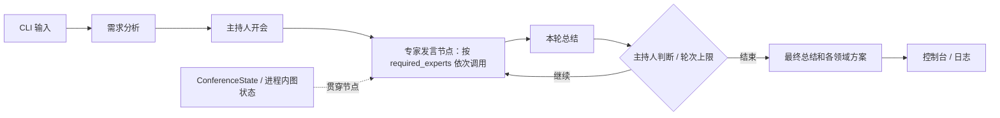
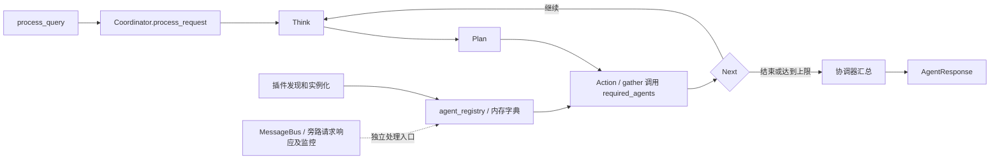
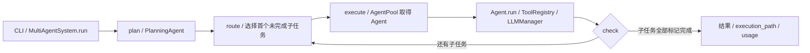

# 当前项目架构（基于源码）

核对日期：2026-11-12。源码基线：`5e8a52d47357a10767821ebeee8200a44bc3b085`；开始分析时工作区干净。本次仅新增文档和图示，未启动应用、调用模型或外部业务接口。主要读取文件的 SHA-256 见[源码快照索引](ai-archtect/source-snapshot.json)。

## 1. 总体判断

当前仓库是多个可独立研究和运行的 AI 示例项目集合，已经覆盖聊天、模型请求封装、LangServe API、RAG、MCP 工具接入和几种多 Agent 流程。它尚未形成统一的多智能体运行平台：未发现贯穿各应用的 Agent 注册中心、统一 Run/Task 状态库、A2A 协议端点或四种协作模式的统一运行接口。

根目录 `main.py` 是 `lib_request` 的调用示例，默认执行相似性检索示例，不是各子项目的总入口。README 中的方向和完成勾选表达项目意图；本图以代码实际调用关系为准。

## 2. 当前整体架构图

[查看 PNG](diagrams/current-architecture.png) · [编辑 Mermaid 源文件](diagrams/current-architecture.mmd)

实线表示已找到的代码调用或入口关系，图内按代码归属汇总模块，不代表已经按微服务部署。图中“局部状态”是各模块状态的概览，不是共享状态服务；“模型服务”也不代表统一模型网关。没有画出 WebUI → server、server → 多 Agent 应用的连接，因为所读主要入口没有这类集成。server 的禁用 RAG 路由只在节点文字标注，不画成已接通链路。

## 3. 模块、入口与实现边界

| 模块 | 入口与关键源码 | 当前实现 | 边界 |
|---|---|---|---|
| `webui-chatbot` | [home.py](../webui-chatbot/src/home.py)、[chat.py](../webui-chatbot/src/pages/chat.py)、[pdf_search.py](../webui-chatbot/src/pages/pdf_search.py) | Streamlit 多页面；页面直接构造模型客户端；PDF/Word → 切块 → Embedding → FAISS → 检索对话 | 页面同时承载界面和业务；未统一经由 server |
| `server` | [server.py](../server/app/server.py)、[routes_config.py](../server/app/routes/routes_config.py)、[init.py](../server/app/routes/init.py) | FastAPI 启动时读取配置，`importlib` 导入模块并调用 `register_route`；LangServe 暴露链；提供 `/health`、`/routes` | 这是模块化路由装配；没有注册管理 API、配置发布、Agent 生命周期或运行中热更新 |
| `graph_discussion` | [main.py](../graph_discussion/main.py)、[graph.py](../graph_discussion/graph/graph.py) | LangGraph 会议流程，需求分析、主持人、三位专家、轮次总结和最终汇总 | 专家字典在建图时固定；专家发言节点里是顺序 `for`；未配置持久化 checkpointer |
| `agent_muti_discussion` | [main.py](../agent_muti_discussion/main.py)、[session_manager.py](../agent_muti_discussion/src/core/session_manager.py) | SessionManager 驱动需求分析、固定专家讨论、主持人判断、一致性检查和总结 | 会话历史和轮次保存在对象内存；不是通用分布式协作协议 |
| `agent_muti` | [agent_system.py](../agent_muti/src/core/agent_system.py)、[coordinator_agent.py](../agent_muti/src/agents/coordinator_agent.py)、[iteration_controller.py](../agent_muti/src/core/iteration_controller.py) | 协调器管理 Agent 字典；Think → Plan → Action → Next 迭代；Action 用 `asyncio.gather` 并行调用所选 Agent | 进程内动态注册，不具备跨进程目录、租约或版本发布；主查询路径直接调用协调器 |
| `agent_muti` 扩展 | [plugin_manager.py](../agent_muti/src/core/plugin_manager.py)、[message_bus.py](../agent_muti/src/utils/message_bus.py) | Python 包/文件插件发现和实例化；内存 PriorityQueue、订阅回调和请求响应 | 插件导入会执行代码；消息总线不是 A2A，也不是持久消息中间件；它不构成主执行路径的唯一入口 |
| `manus` | [main.py](../manus/main.py)、[workflow.py](../manus/src/graph/workflow.py)、[agent_pool.py](../manus/src/agents/agent_pool.py) | AgentPool、LLMManager、工具注册表；LangGraph 规划、路由、执行、检查循环 | Agent 配置在初始化时消费；节点通过全局变量取得 AgentPool；图未配置持久化 |
| MCP 客户端 | [mcp_manager.py](../mcp_client_manager/src/core/mcp_manager.py)、[mcp_client.py](../mcp_client_manager/src/core/mcp_client.py)、[agentmcp.py](../agentmcp/agentmcp.py) | MCPManager 注册服务、发现 tools、提供模型工具描述和调用；另有 AgentExecutor 示例 | 当前注册数据在内存；没有健康租约、持久目录和统一授权；注册的是 MCP 工具服务 |
| MCP 服务 | [天气](../mcp_weather/main.py)、[数学](../mcp_server_math/main.py) | FastMCP tools/resources，入口使用 SSE transport | 独立进程；不提供 A2A Agent 任务生命周期 |
| RAG / 数据示例 | [rag_llamaindex/app.py](../rag_llamaindex/app.py)、[csv-search/llm.py](../csv-search/llm.py) | LlamaIndex 本地模型/索引；CSV 导入 SQLite 和 SQLDatabaseChain | 未接入 server 的 RAG 路由；不可与会议工具中的模拟 RAG 混为一谈 |
| 公共库 | [lib_request](../lib_request/README.md)、[lib_graph](../lib_graph/README.md)、[lib_hello](../lib_hello/README.md) | 请求/Embedding/相似检索封装、LangGraph 示例、SDK 打包模板 | 各自打包，不是平台公共契约；`lib_graph` 的内存 checkpointer 示例不代表其他应用已有持久恢复 |

## 4. 三条主要 Agent 调用链

### 4.1 LangGraph 会议讨论

`Moderator.ask_question()` 虽然定义了追问方法，但当前图没有把它接入循环；继续讨论时直接回到 `expert_speak`。专家可以参考近期发言。工具注册表由专家使用，其中 `WebSearchTool` 是模拟搜索，`RAGTool` 是内置文字知识集合，不能作为真实联网检索或外部知识库接入的证据。

### 4.2 动态 Agent 与迭代协调

主路径由 `process_query → coordinator → iteration_controller` 执行，不通过 MessageBus 派发。`_action_phase` 读取了 `execution_sequence`，但实际按 `required_agents` 建任务并 `gather`；不能据此认定已实现通用 DAG 依赖调度。另有 `PlanningEngine` 类，不能因为它存在就把它画成主链路已消费的组件。

### 4.3 Manus 规划执行

`execute_node` 即使拿到失败结果，也会把子任务的 `completed` 标记为真；`check_node` 只检查此标记。因此这里的“流程完成”不等同于“全部子任务成功”。`manus/src/memory/conversation.py`、`vector_store.py` 当前是空文件，不能计为已实现长期记忆。

## 5. 面向平台的差距

| 目标能力 | 现有基础 | 需要补齐 |
|---|---|---|
| 动态注册 | 本地 Agent 字典、插件加载、MCP 服务注册方法 | 稳定身份、定义版本、实例租约、健康、持久目录、管理 API、下线排空 |
| 动态配置 | YAML/TOML/Python 配置和部分 setter | Schema、不可变 revision、发布/回滚、运行绑定、并发更新控制、密钥引用 |
| A2A 通讯 | MCP 和自定义进程内消息 | 官方协议适配、Agent Card、任务/上下文映射、鉴权、流恢复和跨服务失败处理 |
| 四种协作 | 主持人/协调器、规划循环、并发调用 | 同一运行内核上的四种策略、明确控制权、状态合并、退出/收敛条件 |
| 可靠运行 | 局部超时、日志、性能统计 | 持久 Task/Attempt、执行租约和隔离、幂等、副作用对账、取消和崩溃恢复 |
| 工程与运维 | 多个 requirements、部分锁文件、单个 server Dockerfile | 独立依赖边界、统一契约测试、可观测性与多租户隔离 |

依赖需先统一验证：根 `requirements.txt` 多数未固定版本，`graph_discussion/requirements.txt` 固定了旧版 LangGraph/LangChain，而 server 使用另一组约束。未执行安装，不能认定这些项目可以放在同一环境稳定运行。

## 6. 取证与验证口径

- 已做：入口/导入/调用链静态阅读、关键能力搜索、源码哈希记录、图示和文档校验，详见[交付检查记录](ai-archtect/validation.md)。
- 未做：应用启动、依赖兼容测试、真实模型/MCP 调用、A2A 互通、性能、部署或业务验收。
- 不读取或复制 `.env` 内容；新方案示例只使用 secret 引用。现有配置不会在本次文档任务中改写。

下一步设计见[多智能体运行平台方案](ai-archtect/README.md)。
