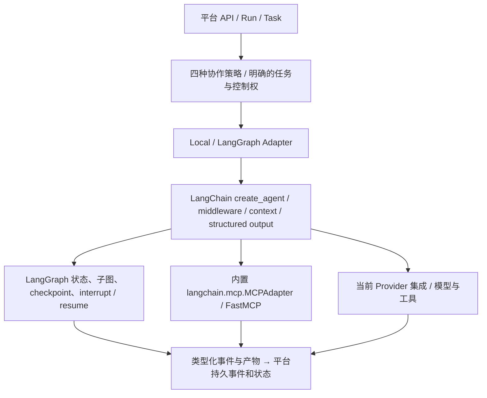

# LangChain / LangGraph 当前特性采用基线

修订日期：2026-11-12（Asia/Shanghai）。状态：**方案已更新，特性接入和兼容验证未执行**。本文补充 S01–S11 的技术选择，不增加一个新的 S12 步骤。需求：采用当前最新稳定版本及适合平台的新特性，旧兼容层不成为新平台的默认实现。

## 1. “合并”的准确含义

LangChain 的高层 Agent 入口统一到 `langchain.agents.create_agent`，其返回的 Agent 运行在 LangGraph 上；LangGraph 继续作为可独立使用的状态图和执行运行时，具有自己的包与版本。因此这是高层 Agent API 与底层运行时的统一组合，**不是把 langchain 与 langgraph 合成一个发行包**。[LangGraph 官方说明](https://docs.langchain.com/oss/python/langgraph/overview)、[LangGraph v1 与 LangChain 的关系](https://docs.langchain.com/oss/python/releases/langgraph-v1)

项目采用：单 Agent 使用 create_agent；多 Agent 的显式状态、分支、并发与转交使用 StateGraph/子图；平台 Runtime 管理业务 Run/Task、授权、租约、预算和外部回执。Agent middleware 与子图不再自建另一套跨平台调度器。

## 2. 当前核验版本与版本策略

| 组件 | 2026-11-12 核验的稳定版本 | 本项目处理 |
|---|---|---|
| LangChain | [1.5.0](https://pypi.org/project/langchain/1.5.0/) | 最新稳定候选；不再以“能运行旧 API”作为升级完成标准 |
| langchain-core | [1.8.0](https://pypi.org/project/langchain-core/1.8.0/) | 配合 LangChain；最低 Python 3.11 |
| LangGraph | [1.2.20](https://pypi.org/project/langgraph/1.2.20/) | 仍单独锁定；保留自定义图与子图 |
| langchain-openai | [1.7.4](https://pypi.org/project/langchain-openai/1.7.4/) | 当前 provider 候选，验证现有兼容服务 |
| OpenAI SDK | [3.49.0](https://pypi.org/project/openai/3.49.0/) | 当前稳定候选；移除原计划仅为保守而设的 `<3` 上限，验证原生 SDK 消费者 |
| FastMCP / MCP SDK | [4.1.8](https://pypi.org/project/fastmcp/4.1.8/) / [2.3.0](https://pypi.org/project/mcp/2.3.0/) | 新 MCP 路线的候选；与旧适配器环境隔离 |
| Python | 3.12.x | 执行时固定可用 patch；满足 LangChain 1.5 的最低版本 |

核验了 PyPI 的 `Requires-Dist`：LangChain 1.5.0 需要 core `>=1.8,<2`、LangGraph `>=1.2.12,<1.3`，其 `mcp` extra 需要 FastMCP `>=4.0.11`；FastMCP 4.1.8 的 client/server extras 使用 MCP SDK `>=2.3,<3`。以上是元数据交集，不是已求解的完整锁。[LangChain 元数据](https://pypi.org/pypi/langchain/1.5.0/json)、[FastMCP slim 元数据](https://pypi.org/pypi/fastmcp-slim/4.1.8/json)

实施开始时复核最新稳定发布、撤回和依赖约束；若有更新优先评估，再锁精确版本和 hash。运行和部署不使用无边界 `latest`。预发布和单项 beta 特性分别记录，不能因主包稳定就把所有新 API 都标为稳定。

## 3. 必须采用和验证的能力

| ID | 当前能力 | 在平台中的落点 / 步骤 | 实施验收要求 |
|---|---|---|---|
| LC-F01 | `create_agent` 统一 Agent 入口 | S01、S03、S06；替换业务直接使用 AgentExecutor/create_react_agent | 工具多轮、终止、错误、结构化结果和旧样例回归 |
| LC-F02 | middleware | S03/S06；动态 prompt、工具选择、脱敏、限流/重试与总结 | sync/async 一致；中断不得被当失败重试；外层预算仍有效 |
| LC-F03 | `response_format`、ProviderStrategy/ToolStrategy、`structured_response` | S02/S06；计划、监督决策和报告使用强类型合同 | 根据模型能力选策略，非法输出拒绝或有界修正，不靠“继续/结束”关键词 |
| LC-F04 | 标准 `content_blocks` | S01/S03/S10；文本、多模态、引用和工具内容统一处理 | 不假定 content 永远是字符串；保留来源，敏感内容按可见范围投影 |
| LC-F05 | `context_schema` / Runtime / ToolRuntime | S02/S03；注入身份视图、资源引用和配置 | 消除全局 AgentPool/会话耦合；context 不替代认证、不能从模型参数取得 tenant 权限 |
| LC-F06 | Event Streaming，`stream_events(..., version="v3")` | S03/S04/S10；消息、tool calls、状态、子图的类型化投影 | 增量按 delta 合并，记录最终 usage；映射成平台持久事件，断流不等于取消 |
| LC-F07 | 内置 `langchain.mcp.MCPAdapter` | S01/S03；新平台首选 MCP 工具入口 | beta 包装在资源 Adapter 内；多服务发现/调用、错误、关闭和等待输入通过 |
| LC-F08 | StateGraph、子图与显式控制流 | S03/S06/S08/S09；四种模式组合 | 与 create_agent 共用 LangGraph 运行基础，不写四套独立执行循环 |
| LC-F09 | checkpoint、store、interrupt/resume | S04/S08；暂停续答、恢复和长期数据接口 | 持久后端、独立 thread/namespace、重启和副作用对账；不把内存 saver 当持久化 |
| LC-F10 | 1.5 新增 ModelRouterMiddleware / auto mode | S03/S06 的可配置验证项 | 官方标 beta；只在获准模型候选内路由，实际选择/成本可追溯，保留静态路由配置 |

来源分工：[Agent v1 的入口/内容块](https://docs.langchain.com/oss/python/releases/langchain-v1)、[middleware 组合](https://docs.langchain.com/oss/python/langchain/middleware/overview)、[结构化输出](https://docs.langchain.com/oss/python/langchain/structured-output)、[Runtime 注入](https://docs.langchain.com/oss/python/langchain/runtime)、[Event Streaming](https://docs.langchain.com/oss/python/langchain/event-streaming)、[1.5.0 release](https://github.com/langchain-ai/langchain/releases/tag/langchain%3D%3D1.5.0)。这些是本次计划的能力输入，不代表本项目已接入。

## 4. MCP 路线修正

旧计划把 `langchain-mcp-adapters 0.3.2 + mcp 1.x + FastMCP 2.x` 作为默认兼容组合。该组合只能用于旧入口过渡；**新平台改用 `langchain[mcp]` 的内置 MCPAdapter + 当前 FastMCP/MCP SDK 候选**。官方 MCPAdapter 当前仍标 beta，使用资源 port 隔离 API 变化，照常进行新版特性验证。[官方 MCP 入口与成熟度](https://docs.langchain.com/oss/python/langchain/mcp)

具体迁移需要同时覆盖：

- 工具发现与配置：旧 MultiServerMCPClient 的配置转换为内置 MCPAdapter 的目标和多服务配置，工具身份/前缀不能因迁移丢失。
- transport：新服务优先 Streamable HTTP；旧 HTTP+SSE 只作为具名兼容 transport，不能把旧 `/sse` URL 当作新默认连接方式。
- 资源与提示词：内置 MCP 工具包装不覆盖全部 prompts/resources 接口；需要时经受控 FastMCP Client port 调用，不能悄悄删除现有资源能力。
- 等待与错误：elicitation 进入 interrupt/resume 与平台 waiting_input 流程；中断不当作工具错误重试。未支持的 sampling/roots 明确拒绝，不能默默降级成成功。
- 环境：旧 adapters 仍要求 MCP SDK `<2`，新组与旧组不得在同一环境强装。独立旧服务可经协议临时桥接，登记明确的迁移终点。

迁移语义依据[官方 adapters 迁移指南](https://docs.langchain.com/oss/python/migrate/langchain-mcp-adapters)。新平台默认路径不保留旧 adapters 的依赖约束；不是由旧库限制新平台使用当前特性。

## 5. Beta、版本更新与完成标准

`langchain.mcp` 和 ModelRouterMiddleware 在本次核验中为 beta；分别进入具名配置和测试矩阵。开发/验证环境按新路线接入，精确锁定 SDK/API；发布候选是否启用由实际验证结论决定，关闭该项应有可解释的降级结果。稳定核心能力不因 beta 实验失败而回退到旧 AgentExecutor。

S01 的升级验收加入 LC-F01/04/07 的最小切片和其他项的 API/合同验证；S03/S04/S06/S08/S10 分别完成对应集成。源码中可用符号、依赖安装、机制测试和真实模型效果分别记录。不能仅把 requirements 改到新版本就宣告采用了新能力。

本次仅更新方案：依赖求解、代码改造、新特性运行、真实 MCP/模型、性能和生产验证均为 **not_run**。
