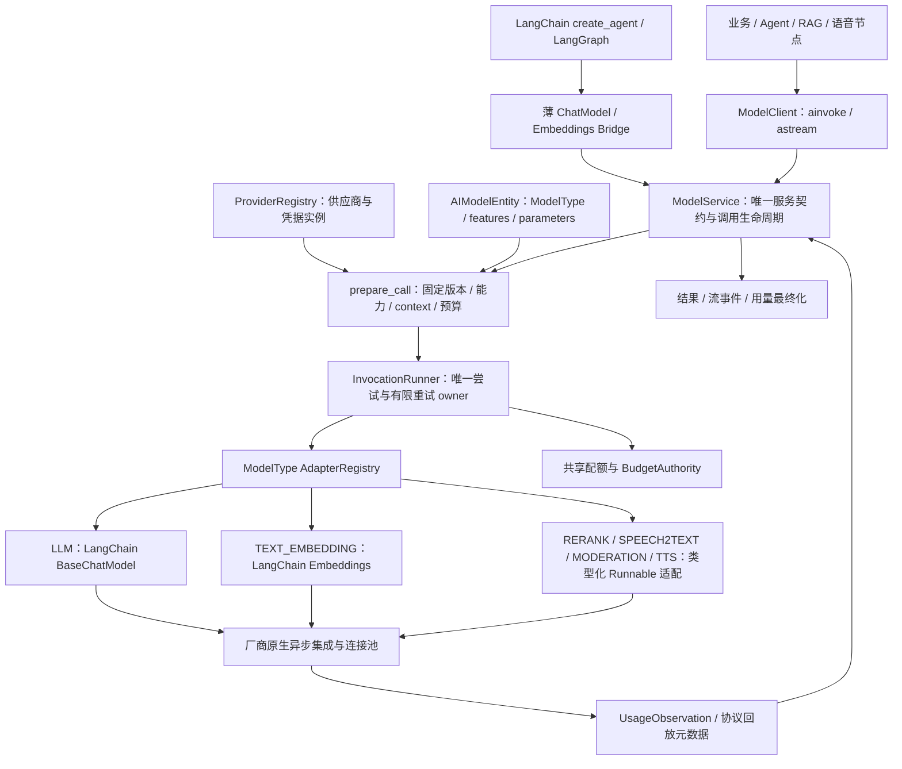
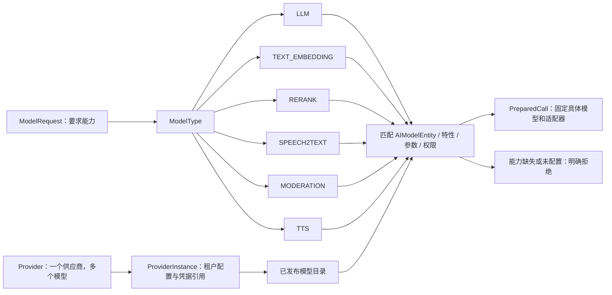
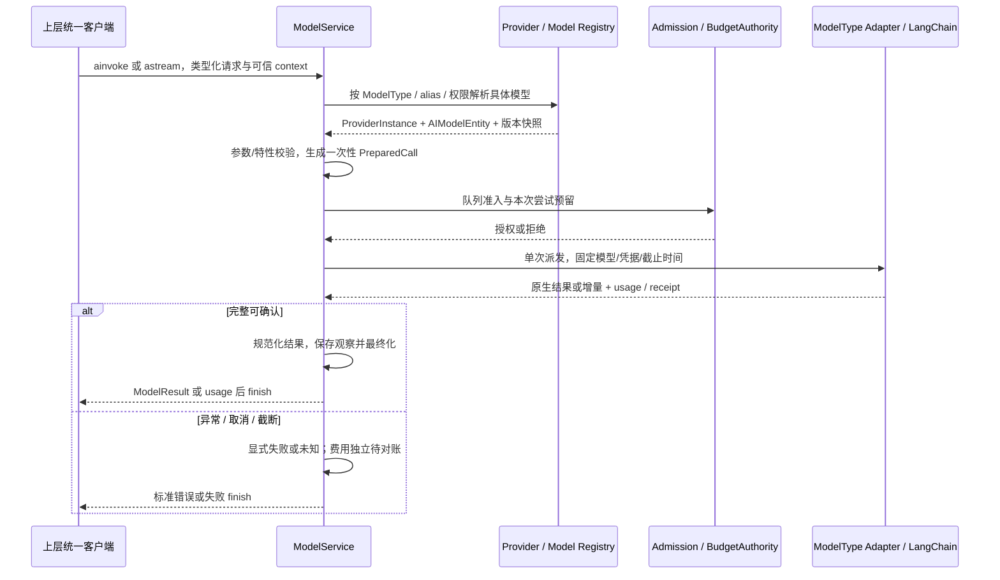
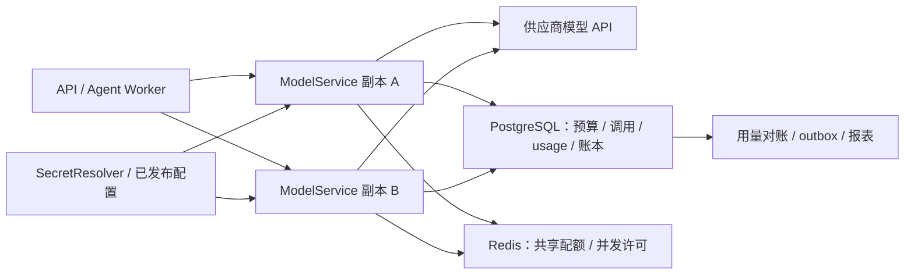

# 01 · DeepSeek 主服务模式与 LangChain 实现架构

日期：2026-11-12。版本：v0.2。状态：设计重写完成，实施not_run。本轮采用依据见 [05](05-open-source-reference.md)，源码与变更基线见 [source-baseline.json](source-baseline.json)。

## 1. 架构目标和主次关系

本项目采用DeepSeek Harness llm的**服务契约为中心**的架构，而不是让各业务直接选择requests、原生SDK或LangChain。ModelService是唯一调用seam：注册/查询能力、准备调用、执行与标准结果/流。LangChain是CapabilityAdapter内部的模型集成和异步执行框架，不成为第二个模型治理服务。

Dify提供Provider/ModelType/AIModelEntity的组织视角，扩展该seam到六类能力；不直接引入Dify运行时。模块仍属于现有六层架构的L5模型资源边界；L2提供发布配置，L4提供Run/Task上下文与预算授权，L6提供持久化、密钥和共享配额。

## 2. 逻辑架构

图例：所有新节点均为拟建，实线表示调用/观察路径。各节点是逻辑职责，不意味着独立微服务。Graph桥接和统一客户端最后进入同一个ModelService，不允许一条路径绕开预算、身份或usage事实。

| 边界 | 职责 | 不承担 |
|---|---|---|
| ModelClient | 对上层暴露ainvoke/astream、模型目录查询；绑定可信context的轻视图 | 不保存所有用户的会话，不发第二遍请求 |
| ModelService | 统一校验、prepare_call、执行包装、结果/流、最终化 | 不执行Agent工具循环，不改写Task成功状态 |
| ProviderRegistry | 管理ProviderDefinition、租户ProviderInstance、支持的ModelType、凭据验证与目录来源 | 不通过名称或/models列表自动授予模型能力 |
| ModelCatalog | 不可变AIModelEntity和按类型/租户的别名/默认值 | 不将特性等同类型，不存secret原文 |
| CapabilityAdapterRegistry | 按model_type/backend_kind装配已安装的能力适配器 | 不任意下载或import用户提供代码 |
| InvocationRunner | 一个逻辑调用及多个明确ModelAttempt的唯一执行/有限重试owner | 不重试业务工具，不成为另一个Agent scheduler |
| Observation/Finalizer | usage、厂商回执、取消/失败观察，统一账本最终化 | 不按UI或callback数量重复入账 |
| 基础设施ports | SecretResolver、BudgetAuthority、Admission、Ledger、对象存储与遥测 | 不产生业务身份/预算权限 |

contracts/domain不导入厂商SDK、LangChain、FastAPI或数据库。LangChain类型仅在其执行适配和Graph桥接内部使用，外部wire与Provider实体保持项目合同。业务层从“某厂商某类Client”改为“请求某类能力”。

## 3. Provider 与模型能力的关系

ProviderDefinition是代码/配置提供的供应商规范；ProviderInstance是某租户已配置的认证/endpoint实例。一个ProviderInstance可以有多个模型和多个ModelType；同一厂商模型名若提供多个能力，按不同model_type发布独立能力实体，不能用一条模糊记录暗示全部能力。

例如：chat.general可以绑定DeepSeek的LLM模型，embedding.knowledge绑定另一Provider的Embedding模型，speech.output绑定TTS模型。上层都调用同一ModelClient，但请求/结果类型不同。Vision是LLM的features/input_modalities；相似度计算和向量检索属于RAG，不能仅因得到排序就称作RERANK模型。

## 4. 一次调用的生命周期

1. API/Runtime解析可信tenant、subject、charge account和Run budget grant；for_context仅创建不可变视图，不能由普通请求body创建身份。
2. 根据请求类的ModelType、model_ref或该类型默认值解析具体AIModelEntity与ProviderInstance，验证类型、特性、参数、授权和媒体引用。
3. prepare_call一次固定完整语义请求、适配器注册、配置/模型/能力/价格/策略revision、credential version、deadline及输入指纹。异步取secret后仍用同一endpoint和快照。
4. 有界准入和预算预留完成后，InvocationRunner派发一个ModelAttempt。PreparedCall只消费一次；重复消费/配置漂移报错，不重新生成。持久幂等另由调用账本负责，不能只靠内存flag。
5. CapabilityAdapter复用LangChain的原生模型/能力接口；对返回值进行一次规范化。流式保留content/tool/音频/转写等不同事件语义。
6. 收集usage/厂商请求ID及执行观察，最后由同一Finalizer结算/保留未知并提交结果或finish。结果错误、内容拒答和费用状态分别表达。

消费者/中间件自身异常不能全部包装成“厂商可重试错误”。取消只表示本地/远端的可观察停止程度，远端费用未知时仍保留待对账。流缺终态不能默认成功。

## 5. LangChain 封装方式

### 普通业务入口

`ModelClient → ModelService → ModelType Adapter → LangChain集成/原生异步能力`。LLM使用BaseChatModel；Embedding使用Embeddings；其余类型复用可用的LangChain集成，缺统一基类时用类型化异步Runnable包装具体能力。不能把六类全部伪装成BaseChatModel。

### Agent / Graph 入口

bootstrap提供薄`PlatformChatModel`和`PlatformEmbeddings`桥接，满足LangChain消费者接口。它们仍调用ModelService的同一准备/执行内核，不自行构造厂商SDK、重试、扣费或复制Agent循环。tools/response_format绑定产生新请求视图，不修改共享模型。Bridge的_agenerate/_astream由异步内核实现；兼容_generate只委托受控SyncModelClient，不能反过来让异步请求落同步SDK。

性能原则是**一个服务合同、多种边界投影**：内部执行可以保留BaseMessage/AIMessageChunk的原生视图，进入服务时固定同样的语义快照和指纹，不要求每个token先转JSON再反向重建框架对象。公共ModelEvent仅在API/UI等边界投影一次。桥接采用内部受控native projection，不是业务可调用的治理旁路。

桥接层必须覆盖bind_tools、结构化输出、invalid_tool_calls、usage、签名/续答数据、stream和取消。嵌套框架span用logical_call/provider_attempt区分；用户只订阅一条token投影，usage只按ModelAttempt结算。不得用“加一层BaseChatModel”就假定完全透明；相应验收见 [07](07-acceptance-and-review.md)。

AgentFactory可以使用middleware做请求变换、路由建议和Run限额停止检查，但请求最终化和模型调用治理在ModelService。middleware不能另外扣款或叠加同次模型重试。所有消息/工具/Schema变换在prepare之前固定；框架自动注入结构化工具的开销也需纳入预算和实际发送对照。

## 6. 扩展与部署

首期可在Worker中装配模块，保持Provider和能力适配器可替换；多Worker池需要集中密钥出站或独立扩缩容时，ModelClient切换远程调用同一服务合同。部署前才创建共享DB/Redis，不能用本地mock的通过证明多租户付费治理可用。

原子注册借鉴DeepSeek的先校验后替换，配置采用copy-on-write。新请求用新revision，在途请求持有旧handle直到排空；紧急撤销在发送和重试前重新校验。多副本配置发布与撤销的一致性窗口另行明确，不把单进程Map原子替换当分布式事务。

本模块不拥有A2A/MCP/工具权限、Agent四种协作策略、知识索引或业务会话事实；这些上层能力消费统一模型资源。后续能力增加只扩展ModelType/实体/适配器与合同样例，不改写协作策略的厂商分支。
