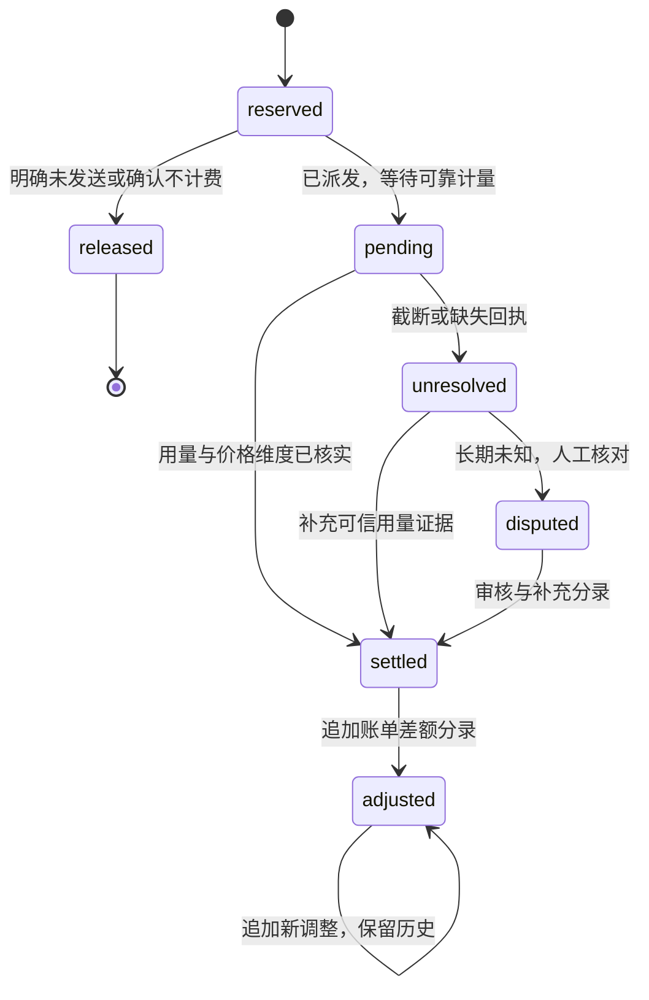

# 03 · 多能力用量、预算与计费合同

日期：2026-11-12。版本：v0.2。状态：设计，持久账务未实现。ModelService产生可核实的调用/用量事实，借共享BudgetAuthority/CostLedger端口预留与结算；不自建另一套账户余额、充值、支付或发票系统。

## 1. 一个调用封套，多种计量单位

按逻辑call关联每次真实厂商请求的ModelAttempt和usage，再归因tenant/user/Run/模型/能力。消息级统计是归因视图，不按消息条数直接推算供应商费用；多轮历史再次发送也可能计费。只有请求级usage时，不能伪造每条消息精确token分摊。

| ModelType | 常见可计量维度（以具体合同为准） | 必须保留的差异 |
|---|---|---|
| LLM | input/output tokens、cache read/write、reasoning、托管工具请求 | cache/reasoning可能是总量子集，不可重复相加 |
| TEXT_EMBEDDING | input tokens、文本/请求批量单位 | 一个逻辑batch可发多次请求；向量维度不是token或费用 |
| RERANK | query-document pairs、搜索单位、tokens或requests | 输入文档数与厂商实际计费单位未必相同 |
| SPEECH2TEXT | 音频秒/分钟、tokens或固定请求费 | 时长来源与向上取整/minimum charge规则须明确 |
| TTS | 字符、文本/音频tokens、秒或请求费 | Unicode计数、编码/voice/tier、输出音频时长各自分开 |
| MODERATION | 文本/图像/requests/tokens，或明确的免费价目 | 免费需有已核实价格revision；缺usage/价格不能当免费 |

因此用量不能只有input_tokens/output_tokens两个字段；公共请求和结果不变，计量按能力/模型扩展。供应商成本与用户售价分开，对外收费策略未确定时只记录成本事实，不启用customer charge。

## 2. UsageObservation

公共头：`observation_id, call_id, model_attempt_id, model_type, source, status, normalizer_revision, observed_at, raw_receipt_ref`。status为estimated/partial/final/missing/inconsistent；source区分provider、local_estimate和对账证据。

计量字段采用 `measurements[{dimension, quantity, unit, source, status}]`，quantity为非负精确数或null。tokens另提供标准投影视图：input_total、互斥input_uncached/cache_read/cache_write_by_ttl、output_total、reasoning子集。未返回的维度保留null，不填0；不同量纲不相加。

归一规则：DeepSeek prompt总量包含cache hit，Harness的inputTokens则是未缓存量；LangChain input_tokens通常是总输入，details是拆分。原始usage和mapping revision必须能回读。reasoning已含于output时不另加；累计/最终usage快照覆盖较旧观察，而LangChain additive chunk只能承载真实增量或一次final，不能将两个累计值相加。

LLM的on_llm_end可观察到模型完成，但随后框架结构化校验仍可能失败，费用不能只按Agent成功记录。此机制已在前轮离线探针观察，见 [回执](../run-01/evidence/langchain-mechanism-results.json)，不是当前账本实现证明。

Embedding/Rerank/音频未必触发LLM callback，也未必从LangChain公共返回值保留完整usage。各CapabilityAdapter必须声明其receipt/usage来源：原生集成元数据、受控SDK解析边界或transport observation。缺字段时保留pending；不能用一个LLM callback覆盖六类后声称计量完整。若标准Embeddings仅返回vectors，须采用局部usage-aware适配或明确缺证，不能按向量数猜token。

## 3. 价格与可复算费用

PriceRevision包含provider/model/model_type/region/service tier、currency、生效期、计量维度、unit scale、舍入/minimum charge规则、来源/核验时间和revision。每次尝试固定匹配版本；新调用换模型/voice/协议或将来显式fallback创建关联调用后须重新匹配，而非运行时读取网上最新价格。

```text
cost = Σ price_rule(measurement, unit_scale, tier, rounding, minimum_charge)
```

只汇总互斥可计费维度；统计子集不能重复计价。货币用Decimal或定标整数，保留原币种；FX另有revision，USD/CNY不直接相加。STT向上取整、TTS字符口径、Rerank单位和长上下文档位必须由PriceRule表达，不硬编码“除1000”。

公式样例使用虚构价格：普通输入2、cache-read 0.2、输出8个货币单位/百万tokens。输入1000其中600命中，输出100，成本=(400×2+600×0.2+100×8)/1000000=0.00172。该样例仅供公式fixture，不是DeepSeek报价或真实账单。未知价格cost=null/unpriced；已核实的免费价格可以是0，二者不能混淆。

用户收费独立使用ChargePolicyRevision，默认disabled。退款或补贴不抹去真实provider cost；消息级分摊若来自估算需标allocation_method，不作为供应商原始事实。

## 4. 准备、预留与结算

PreparedCall包含ModelType、输入规模/媒体限制、模型/价格/策略revision和总deadline。调用前形成可核实费用上界：LLM包含输出/推理/托管收费工具，Embedding和Rerank包含显式batch plan，STT/TTS包含可信媒体/字符上限与计价规则。估算tokenizer不是天然硬上界；不明或无界收费项不能通过严格预算准入。

BudgetAuthority由L4/L6共享实现，模型层消费父Run grant，不自行扩大授权。首个持久实现建议PostgreSQL原子预留：固定顺序锁定相关约束，验证settled+held+new_hold<=limit，写call/attempt/reservation和dispatch intent后提交；事务中不等待模型HTTP。

已知批计划可预留一个总hold再给各物理请求切分子额度，子分配不重复计入余额；重试超过原计划前需额外预留。不能承诺整批外部推理事务回滚。部分批失败仍要记录已发生费用，并按显式partial策略返回或失败。

派发前检查撤销、deadline/owner和有效permit。进程在“意图已提交、HTTP发送状态不明”的窗口崩溃后按unknown对账，不凭重启就重发。ModelService的PreparedCall单次flag与DB幂等分别验收，不能互相代替。

## 5. 结算状态独立于模型结果



失败、取消和流截断都可能已产生费用。仅明确未发送、可信不计费回执或核实结算后才释放对应hold；lease TTL不能证明远端未执行。unknown可进入人工disputed流程，不自动归零。

相同attempt的partial/final/最终消息usage按observation revision归并；同一receipt幂等入账。不同真实请求即使文本相同也不能去重费用。迟到usage/账单通过追加adjustment引用原settlement，保留历史价格与计数；供应商只有聚合账单时记录账户残差，不编造逐调用精准归属。

actual大于预留时如实记overspend anomaly，停止新准入并对账，不能截断真实usage。保证是“不超发已核实平台预留额度”，不是无条件保证未知供应商账单永不超额。

## 6. 持久对象与责任

| 对象/表（拟） | 关键事实 |
|---|---|
| model_calls | tenant/call、幂等键、type、输入指纹、快照、执行状态、结果引用、结算状态 |
| model_attempts | call/attempt/ordinal、physical request、provider ID、dispatch phase、错误/停止与时间 |
| model_usage_observations | 原始回执引用、标准measurements、mapping revision、source/status、观察去重键 |
| model_price_revisions | 计量单位、货币、档位/取整、生效/来源与核验 |
| budget reservations / constraints | 共享authority的hold/子分配、grant、账户与上限，不是本模块第二份余额 |
| cost ledger / adjustments | 追加式费用与差额分录、usage/price refs、唯一业务事件键 |
| model_outbox / reconciliation | 最终化事务中的可重投事件、未决观察、对账责任和依据 |

tenant-owned外键含tenant_id；普通查询强制身份scope，可叠加RLS。原始prompt/完整向量/音频不是账本必需字段，存储引用、hash和必要计量即可；内容/回执分级保留、加密和删除，密钥永不入账务日志。

## 7. 查询与阶段边界

按用户、租户、Run、ModelType、模型、日期查询次数/计量/成本，同时给unknown_count、unpriced_count、pending_hold和watermark。报表异步投影不充当实时余额。raw tokens、字符/时长、钱、credits、容量/吞吐分别展示；不以缺测填0。

S02固定合同和fixture；S03逐能力核对真实usage来源；S04落地共享预算、持久账本和故障恢复。本轮未创建DB/Redis或执行供应商费用对账，完整验收见 [07](07-acceptance-and-review.md)。
