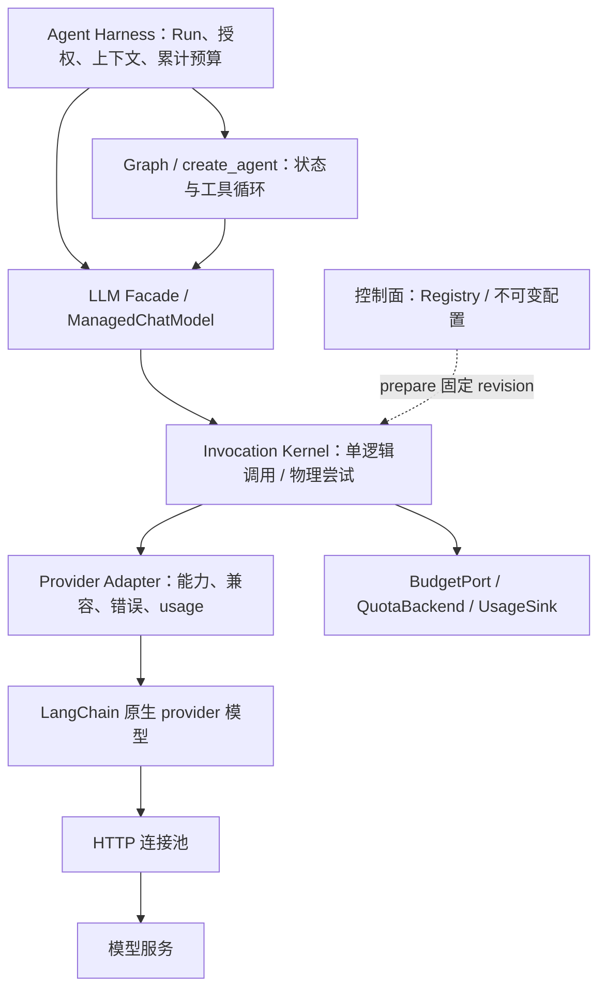
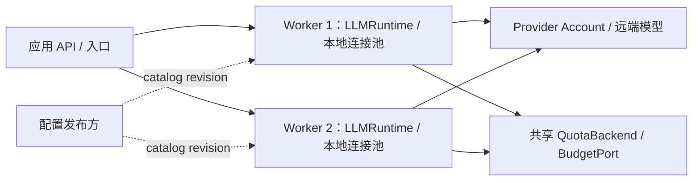

# 02 · LLM 分层、模块与部署设计

日期：2026-11-12。状态：**reviewed / self_review，拟建方案**。本层提供一次模型调用能力，既服务普通业务，也服务 Graph 和 Agent Harness；不要求调用者必须先创建 Agent。

## 1. 逻辑分层与所有权

| 层 | 拥有的事实/行为 | 提供接口 | 不承担 |
|---|---|---|---|
| Agent Harness（外层） | Run/Task、身份授权、上下文/记忆、累计预算、工具授权、执行恢复 | CallContext、BudgetPort、模型选择约束 | 不处理供应商 SSE/HTTP |
| Graph / Agent（外层） | 节点/状态/分支、create_agent 工具循环、checkpoint、协作策略 | 原生 model invocation、工具定义、消息历史 | 不持有 HTTP 连接和供应商凭据 |
| Facade / LangChain Bridge | 易用函数和 BaseChatModel 兼容模型视图，调用输入转换 | achat/generate/stream/structured/chat_model | 不自己执行工具或隐藏重启 Agent |
| Invocation Kernel | prepare、参数校验、调用身份、准入、尝试、完成/异常/清理 | execute、open_stream；调用阶段事件 | 不持久化 Graph 状态，不建立业务任务队列 |
| Provider Adapter | provider 能力、参数/replay/错误/usage 差异、原生 LangChain 模型工厂 | AdapterFactory / AdapterHandle | 不拥有业务租户权限和 Run 调度 |
| LangChain + Transport | Message/Chunk、模型协议、受控 SDK、HTTP 客户端/连接池 | 原生 ainvoke/astream | 不决定平台总预算和配置发布 |
| 配置控制面（侧面） | adapter 注册、provider/model/profile revision、发布和撤销 | CatalogSnapshot / Registry | 不经过每个 token，不是模型执行器 |



实线表示拟建调用/依赖方向，虚线表示配置输入，不表示真实部署连通。独立 [图源](diagrams/layers.mmd) 与本图同步维护。

## 2. 内核唯一调用路径

两种入口共用内核：`llm.achat/generate/stream` 直接进入 kernel；`llm.chat_model` 返回 ManagedChatModel，再通过 kernel 进入 provider。内核最终调用的是 **private underlying LangChain provider model**，不能拿 ManagedChatModel 再调用自己造成递归。

一次调用步骤：规范化与校验 → 固定 ModelBinding/ProviderHandle/连接凭据快照 → 能力与身份约束 → 估算和预算预留 → 有界准入 → physical attempt → 读完结果或流 → usage/finish 规范化 → 结算 → finally 释放。每个物理 attempt 重新通过请求配额准入，整个逻辑调用保持同一配置与总 deadline。

Facade 是易用性层；ManagedChatModel 是框架兼容层；二者都不能绕过 kernel 直接请求 SDK。Provider 工厂只在 bootstrap 按 allowlist 注册；配置不能通过任意 Python import 路径安装代码。

## 3. 核心模块与依赖

建议未来目录，**本轮不创建源码包**：

```text
src/agent_platform/llm/
  __init__.py                 # 只导出公共 API
  facade.py                   # LLMClient、会话无关的便捷调用
  contracts.py                # CallContext、ModelBinding、Usage、Error
  kernel.py                   # 同一生命周期、attempt 与流清理
  catalog.py                  # 不可变配置快照、alias 与能力解析
  registry.py                 # AdapterFactory 注册和 revision 句柄
  governance/
    admission.py              # 有界队列、并发/RPM/TPM 准入
    retry.py                  # 纯策略与可取消等待；只有 kernel 执行请求重试
    budget.py                 # 消费外层预算接口，不另造 Run 总账
  providers/
    base.py                   # Factory、Handle、能力规范化
    openai_compatible.py      # 已验证的非思考兼容路线
    deepseek.py               # LangChain 专用 provider 与 replay 兼容
  langchain/
    chat_model.py             # ManagedChatModel(BaseChatModel)
    messages.py               # codec / provenance / 内容投影
    structured.py             # 保持治理的结构化 Runnable
    sync_bridge.py            # 旧同步入口兼容
  transport.py                # event-loop 作用域的连接池生命周期
  observability.py            # attempt 事实、指标、脱敏 trace
  testing/                    # 可控 adapter 和受控本地 provider 测试夹具
```

单个 distribution 内采用这些模块即可；不逐目录发布独立包。`kernel` 不依赖 FastAPI、LangGraph 编译器、MCP 客户端、数据库 ORM 或业务 Agent 类。core 合同复用 LangChain 消息是有意决定；若纯领域模块不能依赖 LangChain，由应用层自己的 port 转换，不让所有领域都导入模型实现。

扩展新供应商主要新增 AdapterFactory 和能力/错误/参数映射；扩展日志、配额后端或密钥服务实现现有 port；新增 Agent 协作方式不修改 LLM kernel。

## 4. 运行时对象与作用域

| 对象 | 生命周期/共享方式 | 不能放入 |
|---|---|---|
| LLMRuntime | 每进程/owner event loop 一个；应用 lifespan 创建和关闭 | 单请求消息历史、工具执行状态 |
| CatalogSnapshot | 发布后不可变，读取方固定 revision | 明文密钥 |
| ManagedChatModel | 可复用的不可变 model/profile binding；绑定工具返回新视图 | 当前 request_id、可变消息列表、租户鉴权头 |
| ProviderHandle / TransportPool | 按 provider revision、credential scope/version、transport policy、event loop 分组复用 | 随请求修改的默认 headers/cookies |
| PreparedCall | 单逻辑调用，一次性开始；请求字段校验后固定 | 第二次 dispatch、跨调用复用的可变状态 |
| Attempt / StreamSession | 一次物理请求/一次消费；finally 清理 | 未限制的 buffer、永久占用的 semaphore |
| CallContext | 调用/Run 注入，不可变；scope 只传身份/约束/关联 | 明文 secret、未经验证的 prompt 身份 |

异步请求之间不共享可变 messages；规范化时复制容易被修改的 list/dict，绑定 schema 用规范化 digest。请求热路径读取快照，不在网络 await 周围持有注册表写锁。

## 5. 部署选择

首期作为库分别装入 API/worker 进程。异步 worker 负责长连接流；应用创建并注入 runtime，退出统一 drain。LLM 自身不增加常驻跨进程 controller。LLM 包不依赖 LangServe/MCP，也不强制它们共用或拆分 Python 环境。本轮期间根 requirements 已改为统一入口、LangServe 不带 server extra 并显式使用 SSE 3.7.0；只核对了声明，未替并行工作宣称安装通过。历史 [S01 概览](../../01-langchain-upgrade.md) 中的隔离结论不直接当作当前依赖布局。

多进程部署时，每个进程有自己的客户端和事件循环，**provider account 的配额与总预算不能各自复制一整份**。通过 shared QuotaBackend / 外层 BudgetPort 协调，或按 worker 数静态切分配额；细节见 [并发方案](05-concurrency-and-reliability.md)。

独立 LLM Gateway 作为后续选项：只有当多语言调用方、统一网络出口或集中 provider 运维确有收益时采用。它保留相同调用合同，但需要额外解决身份传播、SSE 背压、取消转发和传输失败，不作为本轮默认性能优化。

## 6. 边界约束

- LLM 的 tool calling 只产生 tool_calls，工具由 Graph/Agent 执行；MCP/A2A 不进入本层。
- Context Window 预检不通过时返回类型化错误；上下文压缩、记忆召回由 Harness 决定。
- Provider 元数据或发现不产生权限；调用还要通过上层身份约束和允许 profile/模型范围。
- 重试只处理同一模型生成的物理失败。任务重启、结构化修正、换模型和工具重试均为上层显式新操作，并消费累计预算。
- LLM 记录模型尝试事实和 usage；Run/Task/工具副作用的唯一写入者仍在外层。

## 附图 · 拟建部署示意



独立[图源](diagrams/deployment.mmd)。本轮保留 Mermaid 源码，未执行图片渲染或视觉验收。
