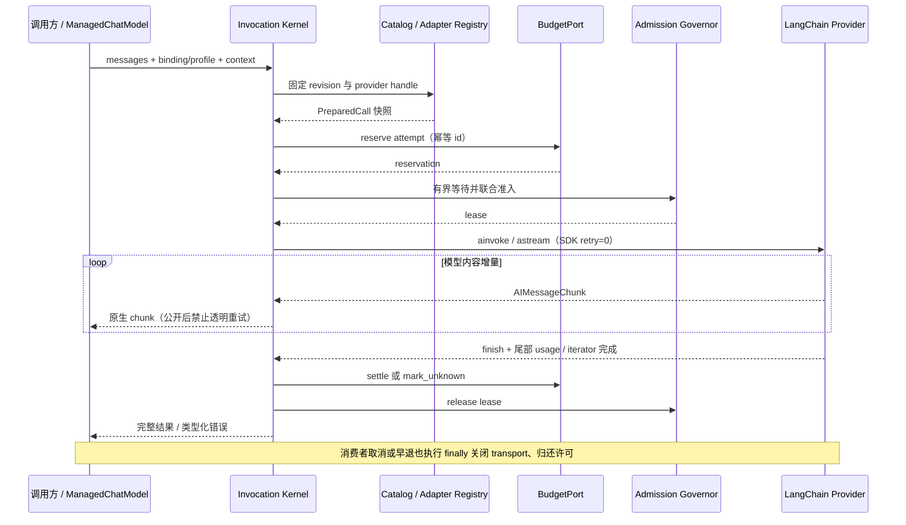

# 03 · 公共合同、消息与易用 API

日期：2026-11-12。状态：**reviewed / self_review，接口拟建**。所有 `agent_platform.llm` 示例是实施合同，当前尚无这些模块。可解析的类型示意见 [contracts.py](examples/contracts.py)。

## 1. 三类消费 API

| 接口 | 合同 | 适合调用方 |
|---|---|---|
| `await llm.achat(input, profile="default", context=ctx)` | 返回原生 AIMessage；不将错误变成文本 | 普通业务、旧 Agent 的 async 方法 |
| `await llm.generate(...)` | 返回 LLMResponse：原生消息 + binding/attempt/usage/accounting 信息 | Harness、审计和需要完整结果的服务 |
| `async with llm.stream(...) as stream` | 流为 AIMessageChunk；`await stream.result()` 得到完整 LLMResponse | SSE/WebSocket 服务、直接消费者 |
| `await llm.structured(schema, input, method="function_calling", ...)` | 单次模型请求 + 本地校验；返回 raw/parsed/调用信息；默认不修正重试 | 提取、分类、独立结构化业务 |
| `llm.chat_model(profile, revision=None)` | 返回 ManagedChatModel(BaseChatModel)，固定当前发布 revision 的模型视图 | LCEL、create_agent、StateGraph、LangServe |
| `async with llm.scope(ctx)` | 为当前调用树注入可信关联/限制；不自行启动子任务或新 Run | 复用已编译图、链、子图 |
| `llm.sync_client()` | 非 event-loop 线程的同步兼容入口，共用同一 async kernel | 旧 CLI、同步图节点；不用于高并发服务主路径 |
| `await llm.abatch(inputs, concurrency=..., ...)` | 有界并发，每个输入仍经过完整准入；结果按输入顺序或显式 as_completed | 批分类/离线处理；不等同 provider Batch API |

`input` 接受 str、LangChain PromptValue、`Sequence[BaseMessage]`；兼容 LangChain message-like 的转换统一放在 facade，服务内部规范化为消息 tuple。字符串是 HumanMessage，不把任意字符串当系统权限指令。PromptValue 转换后仍保留角色及消息内容。

默认只生成一个候选（n=1）。多个输入是多个逻辑调用；一次 batch 不替多个输入共用一个 call_id。超大输入列表先拒绝或由业务分片，不能直接创建 N 个未限制 task。

应用在 composition root 装配一次，具体 port 不要求每个 Agent 重复构造。拟建生命周期接口：

```python
async with LLMRuntime.from_config(
    catalog,
    secret_resolver=secrets,
    budget_port=budgets,
    quota_backend=quotas,
    access_port=access,
) as llm:
    await serve_requests(llm)  # 服务/worker 内复用，退出时统一 drain/close
```

本地开发由 bootstrap 显式装配本地身份、有限预算和 local quota；生产不能静默补一个无上限的默认对象。

## 2. 调用身份与预算上下文

```python
# 拟建；由已鉴权应用 / Harness 构造，非来自模型参数。
ctx = CallContext(
    request_id="req-001",
    tenant_id="tenant-a",
    run_id="run-42",
    budget_ref="budget/run-42",
    deadline_at=deadline_utc,
    allowed_profiles=("default",),
)
```

`request_id` 用于入口关联；`call_id` 由 kernel 为每次逻辑调用生成；每个物理请求生成不同 `attempt_id`，并记录 attempt_index。Graph 的 `run_id/node_name/parent_span_id` 只用于关联，不等于 LLM 的调用身份。

`CallContext` 是调用约束载体，不是鉴权凭证。生产入口从已认证上下文构造它，LLM 在 AccessPort/外层授权结果中核对 profile、租户和预算引用；不能接受请求 JSON 直接覆盖 tenant、credential、endpoint。配置缺少身份/预算时生产模式 fail closed；本地单用户模式可由 bootstrap 明确提供 local identity。

总 deadline 覆盖 prepare、排队、HTTP、读流、退避和必要清理；进入内核时转成本进程 monotonic 剩余时长，不能将 monotonic 时间戳跨进程直接传递。子调用 deadline 不得晚于父调用；外层取消向下传播。

## 3. 调用参数

| 字段 | 意义与校验 |
|---|---|
| `profile` / `binding` | 普通 API 用 profile alias；native 模型视图用已固定 ModelBinding |
| `messages` | 请求内有序消息；调用后外部修改原 list/dict 不影响此次请求 |
| `max_output_tokens` | 大于 0，不能超过 profile 和 provider 已知上限；包含 provider 定义的 reasoning 输出预算 |
| `temperature`, `stop` | None 表示不覆盖；显式 0 必须保留，不能用 truthy 默认逻辑 |
| `reasoning` | mode=off/on/provider_default，effort 为 adapter 声明的值；不猜所有模型的 high 含义相同 |
| `tools`, `tool_choice` | 仅 schema 和模型选择；不传可执行工具状态进 kernel |
| `response_format` / `structured_method` | 显式 schema/策略；仅允许已声明、已验证的能力 |
| `require_complete` | 默认 true；截断/缺少完成证据时报带 partial 的类型化错误 |
| `provider_options` | provider 命名空间中的白名单配置；不提供无限制 **kwargs、任意 headers/base_url 或 callback 代码执行 |

工具 schema 由 LangChain 标准转换函数生成，保留嵌套 `$defs/$ref`、约束和名称；冻结并计算 schema digest 仅用于绑定与缓存，不将其当业务幂等键。未知 option 或互斥参数在发网前拒绝。provider 扩展不能覆盖 kernel 的超时、重试、认证、路由和最大输出约束。

## 4. 结果与错误语义

`LLMResponse` 保留完整 AIMessage：content/content_blocks、tool_calls、invalid_tool_calls、additional_kwargs、response_metadata、usage_metadata 均不因便捷接口被扁平化。`.text` 仅是显示投影；工具调用无文本仍是有效模型响应。

附加信息写入 `response_metadata["platform_llm"]` 命名空间，不覆盖 provider message id 或 model 名：call_id、attempt_id、binding_revision、provider_revision、completion_status、usage_status、accounting_status。持久化使用带 schema_version、LangChain codec_version、provider adapter 版本的显式 codec；原始序列化不能依赖 `str(message)`。

| 场景 | 公共行为 | 自动处理 |
|---|---|---|
| 正常 stop / tool_calls | 返回 AIMessage/LLMResponse | tool_calls 由上层执行 |
| max tokens / 不完整 wire tool arguments | require_complete 报 OUTPUT_TRUNCATED / INVALID_TOOL_CALL，并携带 partial/原始消息 | 不执行不完整工具，不进行 transport retry |
| 结构化 schema 校验失败 | 独立 structured Runnable 或原生 Agent Strategy 负责校验/错误；kernel 不重复做业务 schema 修正 | 默认独立调用不修正；Agent 显式修正消耗新的逻辑调用 |
| EOF 无完成证据 | STREAM_INCOMPLETE；partial 可用于显示，不得提交为成功节点输出 | 不默认为 stop |
| 鉴权、配置、能力失败 | LLMError(code, safe_message, facts) | 不重试 |
| provider 临时错误 | LLMError + retry eligibility facts | 仅 kernel 的单一请求重试策略可尝试 |
| caller task 被取消 | 传播 CancelledError；内部终态为 cancelled | 不转普通模型错误，不重试 |
| observer/调用者消费异常 | 保留调用者异常，finally 关闭流 | 不伪装 provider 错误 |
| provider 成功，结算暂不可用 | 模型事实保持成功，accounting_status=pending；保留 reservation 并通知 BudgetPort | 不再请求模型；外层决定是否暂停后续调用 |

LLMError 至少含 code、call_id、attempt_id（如有）、provider_id、可选 http_status/provider_request_id/retry_after、phase、partial_output、request_effect=not_sent/rejected/unknown。safe_message 不直接透传 provider 原始错误体或完整 URL。`request_effect=unknown` 表示可能已有远端生成/计费；它不表示工具业务副作用，因为本层不执行工具。

## 5. 流协议

面向 Python 的数据流复用 AIMessageChunk；生命周期事件是独立观察接口，不另造完整 token 事件协议。

- 正常消费到 SDK iterator 结束，验证 finish 并收集尾部 usage 后，`result()` 才返回完整结果。
- 工具参数按 tool_call index/id 组合，完整结束前不解析为可执行调用；不逐片段 `json.loads`。
- reasoning/provider replay 保留在内部完整消息中，默认不投影到公共 UI、日志或 tracing payload。
- 先到 finish_reason 的 chunk 不立刻停止；继续读尾部 usage。usage 是快照还是增量由 adapter 声明，不能盲目将快照多次相加。
- 消费者 break 时由 async context manager 调用 aclose；未读完时 `result()` 报 incomplete/cancelled，不自动在后台生成完整回答。
- 异常通过 Python exception 结束，取消走 CancelledError；不 yield 一个普通“错误文本”再正常结束，防止 Graph 当成成功。

```python
# 拟建 API；ctx 的总 deadline 已由上层确定。
async with llm.stream(messages, profile="default", context=ctx) as stream:
    async for chunk in stream:
        await send_to_client(chunk.text)   # 对慢消费者施加背压
    result = await stream.result()        # finish 与尾部 usage 已处理
```

观察事件 vocabulary：call.prepared、attempt.started、attempt.retry_scheduled、attempt.finished、call.finished。每个开始过的 attempt 由一次终态 CAS/finally 确认；事件可重投到 sink，sink 以 attempt_id 去重。StreamSession 不保证崩溃前事件已持久化，最终账务保障由 BudgetPort/UsageSink 的部署实现承担。

## 6. Usage、估算与成本

规范化 usage 为可空字段，并记录 usage.source=provider/unknown；独立 TokenEstimate 标注估算来源和置信度：

- `input_tokens` 是总输入；`output_tokens` 是总输出；provider 提供时保留 `total_tokens` 并检查定义，普通文本模型应为二者之和。
- `cache_read_tokens/cache_write_tokens` 是输入明细；`reasoning_tokens` 是输出明细。**不再次加入总量**。
- DSH 的 inputTokens 为不含 cache 的计数。若从 DSH 格式导入，只有已确认其 disjoint 定义时才将 input+cache_read+cache_write 转为总输入；此项目不直接套用该数字语义。
- 缺 usage 时为 null，不填 0。估算放在 estimated_input_tokens/estimated_output_tokens 和 estimator_revision，不写成 provider usage。
- 成本需要价格 revision、currency、计价单位及 cache 分类映射齐备；缺任一必要事实则 cost=null。可以保留预算 reservation，但不能说成实际消费。
- 重试的每个物理请求都可能计费，不能只统计最终成功 attempt。流中断无法得知 usage 时保留 unknown 和待对账状态。

Prompt/token 估算服务可给 Harness 预检结果，但不压缩会话。不复用参考项目的“字符数/4”作为中文、多模态和所有 provider 的精确 tokenizer。

## 7. 公共 port 与扩展契约

`AdapterFactory` 由代码安装，产生 provider revision 对应的 AdapterHandle；`AdapterHandle` 提供能力解析、原生 LangChain model 构建及参数/错误/usage 规范化。TransportPool 通过显式借还提供 event-loop 本地客户端；CatalogStore 提供原子发布快照；SecretResolver 返回带版本和 endpoint scope 的私密 lease。

AccessPort 提供已认证调用约束核对；BudgetPort 由外层拥有 reservation/settlement/reconciliation，reserve/settle 使用 attempt_id 幂等；QuotaBackend 拥有瞬时容量和请求/token 配额；UsageSink 记录模型尝试事实。它们不反调 Graph，也不写 Run 状态。

详细方法示意见 [contracts.py](examples/contracts.py)。该文件是 Protocol/DTO，不是已实现服务；`ModelBinding`、`PreparedCall` 内部还需持有不可序列化的借用句柄，其明文 credential 永不进入公共 DTO。

## 附图 · 拟建调用时序



独立[图源](diagrams/invocation.mmd)。本轮保留 Mermaid 源码，未执行图片渲染或视觉验收。
