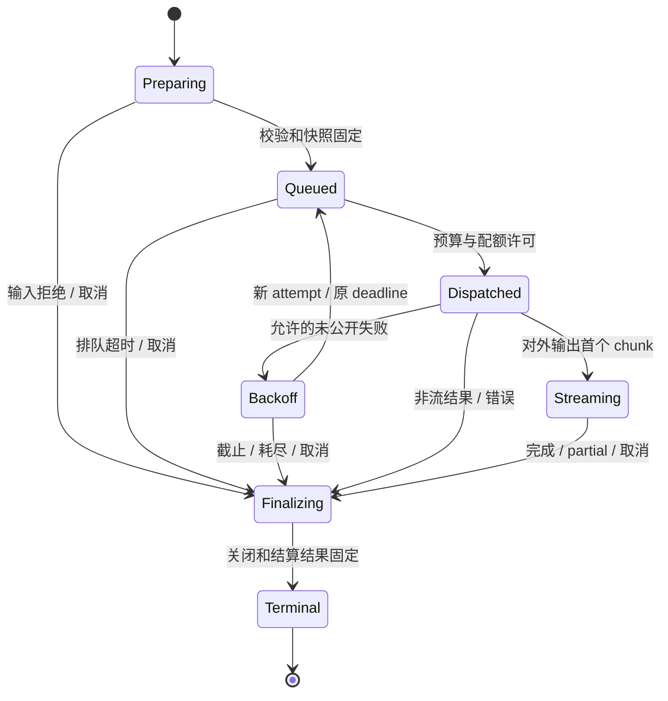

# 05 · 高并发、性能与可靠性

日期：2026-11-12。状态：**reviewed / self_review，设计方案**。本轮未测量项目 QPS/TTFT/资源上限；数值示例只用于说明容量计算，不是实测能力或上线承诺。

## 1. 性能策略及各自解决的问题

| 策略 | 作用 | 不能据此推导 |
|---|---|---|
| 原生 async + 复用 AsyncClient | 减少线程阻塞和 TCP/TLS 连接开销 | provider 生成更快 |
| 每进程/loop 固定 runtime | 复用 provider model、连接池、配置和能力 metadata | 全部进程共享本地 semaphore |
| 有界、按租户公平的准入 | 避免积压挤爆内存，隔离大用户 | 不设配额也能无限吞吐 |
| 并发 + RPM + TPM 联合限制 | 控制实际请求、token 预留和长流占用 | RPM 限制等同并发限制 |
| 单一 retry owner | 避免 SDK×LangChain×Agent 重试放大 | 生成请求天然幂等 |
| 流式增量、尾部一次性收尾 | 降低首段等待和重复 JSON/字符串工作 | 网络断流等于用户取消或输出已完整 |
| revision 模型/连接缓存 | 避免每请求初始化与读取配置 | 用户回答可无条件跨租户缓存 |

## 2. 连接池与 CPU 工作

TransportPoolRegistry 的 key 至少为 `(event_loop_id, provider_revision, endpoint/protocol, credential_scope/version, transport_policy_revision)`。同一 provider/credential scope 下多个 model 可以复用连接；不同认证域、代理/TLS 策略和事件循环不能错误复用。SDK auth 放在固定客户端/请求配置，不在共享 headers 上随请求写入租户信息；CookieJar/默认 headers 不得在不同认证域之间共享。

客户端在启动/预热时创建，provider 关闭时 drain 后 aclose。HTTPX 提供连接与 keepalive 限制，[官方说明](https://www.python-httpx.org/advanced/resource-limits/)；它们与 admission 并发上限一起设置。HTTP/1.1 下活跃长流消耗连接；HTTP/2 有多路复用，连接数仍不等于允许的模型并发数，是否启用要按 endpoint 实测。

token 估算、schema 转换和能力查询不进入逐 token 热路径。工具 schema 只在绑定变化时转换并计算 digest；消息复制/校验一次完成。大规模 tokenization 或文档预处理移出事件循环，必要时使用有界 executor；不得将同步 OpenAI/request/SQLite 调用直接塞进 async 节点。

流内容采用 LangChain chunk 语义和分片累计；显示层可小窗口合并 token，最终结果一次组装，避免每个 token 拼接和重新序列化完整对话造成平方级开销。仅保留本次响应而非重复保留整个输入；设置 input bytes、output bytes、tool arguments bytes 和最大输出 tokens 的上限。

## 3. 分层准入与公平队列

额度归属键是 **provider account / credential scope / upstream quota group**，不能用 profile 名分隔；同一个账号的 deepseek-fast、default、planner 等 alias 必须合并计数。

1. 先做输入大小、profile/能力、身份、deadline 校验，不占 provider 并发槽。
2. 按上层 BudgetPort 为本物理 attempt 做有上限的预算预留；等待过期必须释放或标明未知，不能留下永久 reservation。
3. 进入有界 AdmissionGovernor：配置全局/租户队列长度、队列 bytes、最大 queue wait；超出立即 OVERLOADED，包含建议的本地重试时机，不先启动 HTTP。
4. 用 tenant 分组的 deficit round-robin 或等价公平策略，联合检查账户并发槽、RPM/TPM 和 tenant 分配。在等待 rate token 时不预占并发槽；避免获取多个 semaphore 后反向等待导致死锁。
5. 本次可运行后原子取得许可，在实际 dispatch 前核对 cancel/deadline/revocation。RPM/TPM 只在 dispatch 时提交，未发网的取消可撤销 ticket；已发网请求的 RPM 不因失败退还。
6. 同一个 attempt 的预算、准入和连接借用都在 finally 收尾；已发送但状态未知时保留可能消费的预算/TPM，不按“失败=未消费”全额退款。

原子准入限定在一个 quota_group 内。Redis Cluster 实现需要相同 account hash tag 或明确的分区 actor；跨账户/外部 BudgetPort 不存在天然单事务。跨组件采用先预留、后提交、失败补偿和 attempt_id 幂等，不能声称任意维度一条 Lua 保证原子。

队列只用于短期请求准入，受总 deadline 限制；它不是可恢复业务 Job 队列。长任务调度与重启仍由 Harness/worker 管理。某租户大请求可按估算 token 权重计费公平份额，且保留最大等待/防饥饿规则；估算未知时使用配置的保守权重，不当作准确 usage。

## 4. 多进程与横向扩展

两种运行模式必须显式选择：

- **local / static_partition**：单进程测试，或各 worker 获得固定配额分片，保证分片总和不超已知账户额；不能把全额本地 limiter 复制 N 份。滚动部署、新旧 worker 共存及扩缩容时需重新分配并保留余量。
- **shared**：生产多副本以共享 QuotaBackend 管 RPM/TPM 和并发 lease，本地仅做小队列/内存保护与快速拒绝；请求级原子操作，不每个 token 访问 Redis。共享后端不可用时，生产 fail closed 或进入预先批准的静态保守份额，不能自动退成各副本全额。

lease 包含 owner/attempt/fencing token 与截止时间，活跃请求续租。续租失败本地停止继续请求并取消已有 transport；过期不证明远端生成已停止。owner 崩溃后可能有 orphan 请求，容量保留到请求截止及保护窗口后再回收，结合 provider 限额和余量保守控制。没有 provider 配合，不能证明崩溃场景物理远端并发绝对不超上限。

共享 lease 解决准入所有权，不重做任务恢复控制器。预算 reservation 的持久化与未知用量对账由外层 BudgetPort 拥有；LLM 提供关联和 attempt 事实。

## 5. 流背压与超时分解

默认 in-process 流采用直接 async pull，消费者 await 完才继续取下一块，不额外积累无界队列。SSE fanout 或同步桥需要独立生产者时，buffer 同时限制 chunk 数和总 bytes；chunk 大小时单靠 Queue(maxsize) 不足以限制内存。队列满时等待；consumer_stall_timeout 过期后关闭流，不丢 token 后宣告成功。

| 时间预算 | 覆盖 | 注意事项 |
|---|---|---|
| total deadline | 排队、prepare、尝试、退避和读取 | 不在重试/节点转移时重置 |
| queue wait | Governor 内等待 | 不占 provider 活跃槽 |
| connect / pool timeout | TCP/TLS 与连接池借用 | pool 等待失败不自动当 provider 429 |
| first semantic chunk timeout | 第一个文本/reasoning/tool 参数 delta | 与首个可见文本 TTFT 分开计量 |
| transport read timeout | SDK/HTTPX 等待读取字节 | DeepSeek SSE heartbeat 可能只影响此层 |
| content idle timeout | 正在等上游语义 chunk 的空闲时间 | 不把等待慢客户端发送的时间算上游 idle |
| consumer stall timeout | 本地消费者/通道持续阻塞 | 对慢客户端关闭本次流 |
| cleanup grace | 取消后的关闭和结算安排 | 有界 shield 清理，不无限屏蔽取消 |

LangChain SDK 未必暴露 SSE comment/heartbeat，因此不声称外层 chunk watchdog 能观察所有 wire 心跳。transport read 和语义内容等待是不同指标，使用 SDK 原生 read timeout + 外层语义 timeout；总 deadline 始终有效。

消费者断开后由入口决定是否取消 Run；默认直接聊天关闭本次调用。需要后台继续的任务必须有独立业务 owner 和有效消费者，不能让一个无人读取的生成器悄悄继续付费运行。

## 6. 重试、熔断与失败映射

PreparedCall 只能开始一次；开始后由内核驱动多个受限物理 attempt，每次固定同一语义/连接快照。SDK、LC with_retry、Graph 同类请求重试不能叠加。外层若显式重复一个调用，仍产生新 call_id 并消费同一个 Run 剩余预算。

| 失败 | 自动请求重试条件 | 处理 |
|---|---|---|
| 本地输入/权限/能力/余额错误 | 不允许 | 发网前失败 |
| HTTP 401/403、额度耗尽、无效参数 | 不允许 | 类型化错误；通知配置/预算 owner |
| 已明确未发送的连接失败 | attempt/deadline/budget 允许 | 退避后重新准入 |
| 429 明确拒绝 | provider Retry-After 在剩余 deadline 内 | 有界 jitter，按 quota group 冷却，不唤醒整群同刻重试 |
| 5xx、读超时、连接断开且发送结果未知 | 只有显式 allow_duplicate_generation 策略允许 | 可能重复生成/计费，保留每次 usage/unknown |
| 任意 AIMessageChunk 已越过内核公开边界 | 不允许透明重试/换模型 | 报 partial/incomplete；上层显式决定新调用 |
| caller cancel / 模型正常截断 / schema 解析失败 | 不按 transport retry | 各自终态；保留取消或验证错误 |
| 业务工具失败 / Graph interrupt | 本层不处理 | 由 Graph/Harness 决定 |

默认有界 attempt 数（配置示例为最多 2 次），禁止 always。`Retry-After` 过长不能截短后提前打 provider，应 fail/defer，由上层重排。退避期间释放 provider 并发槽和网络连接；不得占着槽 sleep。空文本但有合法 tool_calls 不属于空响应。

熔断按故障域隔离：账户 quota/鉴权、endpoint transport、模型健康分别统计，不能因为单个用户错误输入熔断所有租户。半开探针受原配额/预算限制；不在请求中擅自探测未知 endpoint。配置错误和权限拒绝不计入 provider 网络故障率。

### 跨模型路由和灾备

v1 在 prepare 前解析明确 profile，默认不透明跨 provider fallback。同一次 PreparedCall 的 attempts 不换 model/endpoint。需要改选其他 profile 时，上层在允许范围、数据去向和 replay 兼容检查后发起新的 call_id，以 parent_operation_id 关联并继续消费同一累计预算。已有输出不拼接另一模型生成；工具/结构化能力不满足时也不能通过静默降级伪装成功。将来增加规则路由可在 prepare 前选择候选，模型驱动路由本身另算一次模型调用，不隐藏费用。熔断只提供健康事实，不能绕过这些选择约束。

## 7. Usage、账务和观察

usage 以 adapter 归一化后原生 metadata 为依据。快照取最终已知值，不能与最终结果重复求和；attempt 维度唯一记账。cache/reasoning 是子集，缺失保留 null；中断未知保留 reservation/上界，待外层对账，不填零。

指标：queue depth/bytes/wait、active calls、physical attempts、per-code error、429、cancel、partial/incomplete、pool wait、first semantic delta、first visible text、total latency、provider tokens、estimated tokens、accounting pending、rejected admission。高基数 request/run/tenant id 进入受控 trace，不作为无界 metrics label。

日志/trace 默认只记录脱敏模型身份、revision、timing、safe error、usage；正文、reasoning、工具参数和鉴权头不默认外发。best-effort telemetry observer 的失败不替换有效模型结果；影响付费安全的 reserve/admit 失败则发网前拒绝。settle 失败保留 pending，禁止为了重新记账再调用模型。

## 8. 容量模型与实验约束

对同质调用，稳态近似 `R <= min(C/L, RPM/60, TPM/(60*E))`：C 是允许活跃请求数，L 是平均占用秒数，E 为每请求平均消耗 tokens。实际 token 规则、突发、reasoning 和输出长度分布会改变结果，不将该式当精确调度器。

**说明性例子**：若 C=120、L=30 秒，则并发约束约 4 请求/秒；将 worker 从 2 加到 8 不改变同一账号 C/RPM/TPM 总额。队列 256 个且每请求上限 64 KiB，仅排队内容上界就约 16 MiB；还需计入活跃流、响应和库对象。上述不是项目实测。

验收按 `mock transport → 本地真实 HTTP/SSE → 受控 provider → 容量回归` 分层。吞吐、p95/p99 等指标及 workload、环境必须同时报告，具体矩阵见 [验收方案](08-validation-and-decisions.md)。

## 附图 · 拟建调用生命周期

独立[图源](diagrams/call-state.mmd)。本轮保留 Mermaid 源码，未执行图片渲染或视觉验收。
