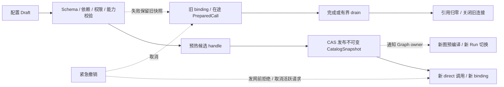

# 06 · 配置、动态注册与生命周期

日期：2026-11-12。状态：**reviewed / self_review，拟建**。本章区分代码 adapter、provider 连接、model 能力与业务 profile；不将一个 model 名当作可变全局配置。

## 1. 配置实体与所有权

| 实体 | 关键字段 | 发布/消费方 |
|---|---|---|
| AdapterDescriptor | adapter_id、implementation_revision、支持协议、config schema | 受控 bootstrap 注册工厂；配置只引用 allowlist id |
| ProviderRevision | provider_id、revision、adapter_id、endpoint、protocol、credential_ref、quota_group、transport_policy | 运维/配置服务发布；调用准备固定 |
| ModelSpec | provider_id、model_id、capabilities、context_window、output_limit、metadata provenance | provider adapter/管理员维护；值可 unknown |
| ProfileRevision | profile_id、revision、provider_revision、model_id、defaults、allowed overrides、capability revision | 应用配置发布；Graph/业务选择 profile |
| Alias | default/planner 等逻辑名 → ProfileRevision | catalog 发布方；进入新调用时解析 |
| PolicyRevision | attempts、timeouts、队列/限额、访问/预算约束 | 配置/平台 owner；调用固定上限并服从紧急撤销 |
| CredentialLease | ref、secret_version、scope、有效期、私密值 | SecretResolver；只在调用准备/客户端构建期间可用 |

model 目录可有未公布的 model id；未列出不是自动拒绝，调用仍需允许范围和能力检查。unknown context/capability 不填无限大或 true；依赖某项能力的调用必须先获得明确验证，或按已批准的非关键未知策略执行并保留 provider 拒绝路径。

## 2. 配置示例与加载优先级

完整拟建 YAML 见 [profiles.yaml](examples/profiles.yaml)。示例采用 default alias 指向 deepseek-flash 的非思考 profile，保留单一账号配额归属；示例是开发配置形状，**配额和 context 未补齐，不能直接作为生产配置**。

加载顺序：bootstrap 默认值 → 配置文件/配置服务的完整 revision → 显式进程环境中的已允许 bootstrap 覆盖；`.env.local` 只供本地 bootstrap 补充尚未设置的环境变量。dotenv 只在入口加载一次，LLM 低层包导入时不扫描 CWD 或修改全局环境。现有 OPENAI_MODEL/BASE_URL/API_KEY 可由一次迁移转换器生成 profile/credential reference，不在每个 Agent 内重新解释。

业务调用只能覆盖 profile 允许的采样/输出等参数，不能覆盖 provider endpoint、credential、quota_group、transport、SDK max_retries。生产环境必须明确 provider 配额、预算和共享后端/静态分片模式；当前未知项应在启动校验中报错或显式进入受限开发模式。

## 3. 注册、发布和失效

```text
adapter 工厂安装（受控代码）
  → 创建 provider/profile draft
  → schema 与引用校验
  → endpoint/credential scope 与策略校验
  → 能力及兼容合同验证
  → 预热本地 handle/连接（不强制付费探测）
  → 原子发布 CatalogSnapshot revision
  → 观察者通知、各应用按自身职责激活
```

注册冲突拒绝，不能覆盖另一个 owner 的 provider id。发布使用 expected_revision/CAS；候选整体验证失败时保持旧快照，不能先 unregister 再 register 产生空窗。回滚发布新 snapshot 指回已保留的旧 revision，保留审计关系；不原地改旧对象。

配置读取可 copy-on-write 原子指针；写锁仅覆盖验证后的小段提交，事件通知在锁外执行。observer 异常记录为配置通知故障，不能让一部分消费者看到“撤回了一半”的内存状态。生产若有多进程，发布结果要区分 catalog 已提交和各消费者 ready，不能将单进程原子性说成集群同时生效。

## 4. 绑定与在途请求

`llm.achat` 在进入一次逻辑调用时解析 alias；`llm.chat_model` 固定调用它时的 profile/model/capability revision。PreparedCall 再借入具体 provider handle 和 credential/连接快照。它只能开始一次，后续 attempts 从此快照创建，不在重试中重新读取 default alias。

| 变更 | 在途模型调用 | 新 direct 调用 | 已编译图 |
|---|---|---|---|
| 普通 profile/model 更新 | 继续旧绑定直到完成/截止 | 读取新 alias revision | 继续其绑定；Graph owner 预编译新图并切换新 Run |
| 同 endpoint/scope 密钥轮转 | 已开始请求继续原 lease | 用当前 secret_version 获取新 client/pool | 语义绑定可复用，下次调用重新借新 secret lease |
| endpoint / protocol / credential_ref 变化 | 原快照不变 | 只能使用相互配套的新 provider/profile revision | 需要新 binding；不把新 key 发到旧 endpoint |
| provider retiring | 已开始调用按 drain policy 完成 | 禁止新 prepare | 旧视图新调用报 route unavailable，由 owner 切换 |
| 安全撤销 | 取消匹配的活跃调用，禁止后续 attempt | 发网前拒绝 | pinned revision 不能绕过撤销，外层决定 Run 后续 |
| 配额降低 | 按新准入限制逐步收敛，不默认杀所有流 | 新准入立即按新上限 | 不改变消息/模型语义 |

密钥轮转沿同一 ProviderRevision 固定的 credential_ref、endpoint scope 解析版本；改变 endpoint 必须新建 revision。SecretResolver 校验 lease 被准许发往此 host/protocol，不接受从消息提供的新 URL。客户端 cache key 含 secret_version，不能让旧 SDK 客户端永远持有已轮转 key。

跨进程恢复只保存公开 binding/revision/codec 引用，不能序列化 PreparedCall、AsyncClient 或活跃 semaphore。若旧 revision 不可用，恢复返回明确兼容/配置错误，由 Harness 决定显式迁移；不默默切模型继续原工具历史。

## 5. Runtime 与资源关闭

应用 lifespan：load/validate → register factory → create runtime → warm handles → serve → stop new admission → cancel queued / drain in-flight → finalize → close pools → dispose registry。每个 stage 有最大等待时间及可回读状态，进程强制终止仍可能留下上游未知生成。

provider 句柄区分 Active / Retiring / Closed；retiring 后不接受新借用，active call 引用归零或 drain deadline 到期后关闭。ManagedChatModel 仅持 binding 引用，不能因为一个长寿 graph 对象存在就永久保留旧 HTTP 客户端。Secret lease 和连接由 runtime 所有，调用借用不能越权关闭共享资源。

取消路径不启动新的模型请求。清理采用有界 shield，分别记录 transport close、quota release、budget accounting 结果。telemetry 失败不覆盖 primary outcome；预算待结算通过 pending 状态和外层对账端口处理。

## 6. 缓存边界与持久化

| 数据 | 拟建策略 |
|---|---|
| CatalogSnapshot | 不可变按 revision 缓存；禁止静默过期回退到任意 provider |
| 模型能力/发现 | 后台 TTL 刷新，可标 unknown；每请求不调 list_models |
| 原生模型/连接 | 按 provider/secret/transport/loop 复用；LRU/容量上限和 drain |
| 工具/schema 绑定 | 只缓存规范化 immutable schema，设条目/bytes 上限 |
| 用户回答 | 默认不缓存；未来需授权/tenant/revision/replay 约束 |
| 会话/Graph 状态 | 本模块不保存；由 session/checkpointer 所有者管理 |
| Usage/attempt 事实 | sink 或外层预算服务按 attempt_id 处理；不靠单进程 dict 当总账 |

配置本身可以 YAML 起步；控制面 DB、配置中心或 Redis 只是实现 port 的选择，不要求第一步同时引入所有基础设施。

## 7. 默认安全边界

密钥通过引用解析，日志只含 provider/profile/revision 与 safe error；不记录 Authorization、完整环境、带 token URL、原始 reasoning。仅经过授权的配置发布方可设置 endpoint，限制协议/host；不能让普通模型调用参数变成任意出站代理。schema、输入、输出和队列都有 bytes 限制。

保留完整 provider reasoning/replay 是协议需要，不代表它可以发往所有观察者。默认只在受限内部消息/会话路径保存所需内容；公开投影只含允许的可见文本/工具摘要。跨 provider 的 opaque replay 不透传；目标 adapter 不支持时要求显式兼容检查或拒绝，不能靠删除必要状态伪装成功。

## 附图 · 拟建配置发布流程



独立[图源](diagrams/config-lifecycle.mmd)。本轮保留 Mermaid 源码，未执行图片渲染或视觉验收。
