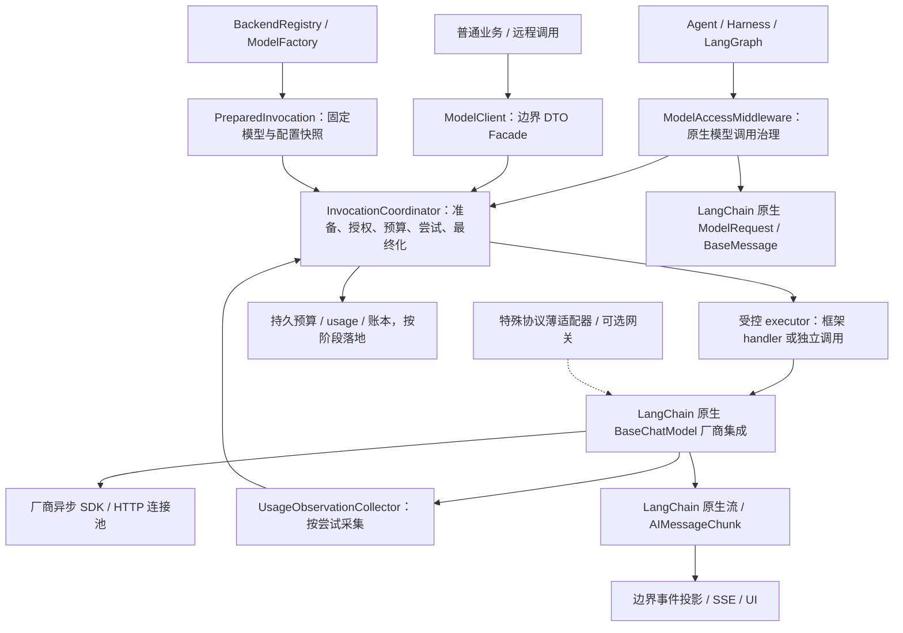

# LangChain 框架下的 LLM 层优化候选

日期：2026-11-12。状态：**待确认候选，未替换 ../llm 正式草案**。本方案结合 [源码分析](00-analysis.md)、当前安装框架源码与 [离线机制证据](evidence/langchain-mechanism-results.json)。没有实现或性能提升百分比的实测结论。

## 1. 核心调整：内部原生，边界稳定，治理共用

保留ModelClient公共边界及预算/身份领域合同；内部模型执行优先使用LangChain原生BaseChatModel、BaseMessage、AIMessage/AIMessageChunk、bind_tools和结构化输出能力。厂商SDK/协议变化交给对应LangChain integration与少量provider patch，不让每个模型调用默认经历自有DTO→手写SSE→自有Chunk→Bridge的往返。



图例：全部为拟建；实线为调用或观察路径，虚线为可选扩展。Coordinator授权executor进行一次尝试，而不是自己再启动Agent；UsageCollector提供事实，不拥有账本写权。图描述逻辑边界，不表示各节点各自部署进程。

### 两类入口与一个执行协调器

- **Agent入口**：AgentFactory固定装配ModelAccessMiddleware；完成请求变换后，由该middleware准备调用、申请配额/预算，再执行框架handler。handler继续调用原生模型，原生工具循环/ToolStrategy归框架。
- **独立业务入口**：ModelClient facade把wire DTO转换一次，调用同一InvocationCoordinator和factory生成的native model；输出在外部边界再转DTO。它不调用Agent入口或形成递归。
- **共用执行内核**：PreparedInvocation、可信context、attempt计数、deadline、admission、BudgetAuthority、usage observation和最终化共用；两入口不能各自扣款、重试或维护余额。
- **原生对象的范围**：允许在LangChain执行适配层内部使用框架类型；租户、预算、账本领域和对外API仍使用项目自己的稳定合同。这样隔离厂商变化，同时避免为潜在换框架付出每token转换成本。

防旁路不是只约定“大家自觉加middleware”：公共bootstrap只导出受控AgentFactory/ModelClient，backend registry不向普通业务开放；已迁移文件做依赖规则检查，配置不允许删除治理middleware。生产密钥/出站只给模型执行域，若要求强制隔离则走远程ModelClient。进程内模块无法防止同权限恶意Python代码绕过，因此不能将代码约束等同安全沙箱。

## 2. Backend plugin 与 PreparedInvocation

### 2.1 不重造所有厂商驱动

拟采用的内部扩展合同（不是已实现API）：

```text
ModelBackendPlugin
  describe(model_spec) -> CapabilityDescriptor
  validate_request(messages, tools, generation, output_contract)
  acquire_model(binding_snapshot, transport_lease) -> NativeModelHandle
  normalize_usage(observation) -> UsageObservation
  export/import_continuation(envelope) -> scoped protocol state
  classify_failure(error, provider_observation) -> FailureObservation

ModelFactory.prepare(request, trusted_context) -> PreparedInvocation
InvocationCoordinator.execute(prepared, native_executor) -> outcome
```

NativeModelHandle包含BaseChatModel/受控Runnable与其生命周期引用，不是provider HTTP wire response。插件约定具体支持的能力与依赖版本，不允许用户注册任意import路径。

第一插件复用S01已安装的langchain-openai，使用DeepSeek非思考、Chat Completions profile，继续验证usage、工具和错误。第二个候选采用LangChain原生厂商integration检验协议差异；新依赖/凭据未核验，不称已可用。只有native integration确实缺失某个协议能力时才实现局部BaseChatModel适配；不默认同时引入pi-ai、LiteLLM SDK和多套parser。

### 2.2 执行对象提前固定

PreparedInvocation固定：call/operation/model_attempt IDs、trusted tenant/subject/budget grant、消息/工具/输出合同指纹、provider/模型/endpoint/协议、capability/policy/price/config revisions、credential version、backend handle、deadline和retry envelope。取消信号是独立活通道，不塞进持久配置。

准备/发送顺序：验证与转换→绑定完整snapshot→异步解析该snapshot的secret/transport→完成准入和预留→检查撤销/lease/deadline→执行。不能在await凭据之后重新从全局active config取endpoint，也不能每个chunk重新resolve模型。

需要明确一个框架边界：create_agent会在实际handler内部绑定tools/response_format，可能注入结构化输出工具。middleware里的PreparedInvocation首先固定的是语义请求快照，不能直接称为完整厂商wire payload快照；估算必须纳入response_format及注入Schema开销。POC要捕获实际发送样例对照；若要求发送前严格验证最终payload，使用对应integration支持的薄边界/transport hook，不能依赖私有_get_bound_model或假装原始messages就是最终计费输入。无法形成可核实预留上界时按原预算规则拒绝硬预算调用。若变换middleware修改模型/消息，必须发生在prepare之前；所有实际发送只使用准备对象。

参考prepareCall的进程内一次性派发限制可保留，但持久幂等另由数据库/Runtime负责。LangGraph恢复使用固定logical operation ID和旧请求指纹，不以新的callback run_id作为业务幂等键；已知结果复用原回执，unknown不默认生成一次。

### 2.3 工厂、模型和连接复用

- 按provider endpoint/协议、credential namespace+version、传输配置和模型配置revision缓存client/model handle。BYOK必须包含租户凭据域；只有获准共享平台凭据才跨用户复用连接。
- 模型缓存miss采用per-key singleflight，避免并发200请求创建200个client；锁只覆盖创建，不覆盖网络推理。
- `.bind()`/`.bind_tools()`产生请求绑定，不修改共享model、headers、profile、callback列表或tenant。固定工具Schema可按revision缓存编译结果，用户动态参数不进入全局可变模板。
- 配置发布使用copy-on-write：旧handle引用计数排空后关闭，新请求用新revision。不能在流中替换模型对象；同样不把HTTP client跨不同事件循环长期复用。
- 不做每token深拷贝整个历史。对象跨持久/API/不可信插件边界时detach一次；安全请求变换采用copy-on-write。BaseMessage并非天然深度不可变，须用变换规范和并发污染测试保护，不仅仅加frozen dataclass。

## 3. 原生异步与双执行路径

**原生异步是准入条件，不是看方法名字。** 当前安装core 1.8.0的BaseChatModel默认_agenerate和_astream会使用executor；langchain-openai 1.7.4实际实现了native async。离线探针已验证sync-only和native-async走不同线程路径，但未证明真实网络吞吐。[BaseChatModel参考](https://reference.langchain.com/python/langchain-core/language_models/chat_models/BaseChatModel)

插件验收须检查其具体实现与取消/连接关闭行为，不仅检查hasattr(ainvoke)。同步旧模型可在隔离、限额的legacy profile中运行，不进入高并发主路径；禁用在async API里直接invoke/requests或调用asyncio.run。

**generate与stream共享语义和治理，不强制共享同一物理实现。** 只需要最终答案的摘要/分类可走native ainvoke非流式；用户需要增量时走native astream/框架event streaming。LangChain可能根据callbacks/运行上下文自动选择流式，必须按实际入口验证，不凭调用了ainvoke就断言上游非流式。选定profile要明确是否允许自动stream；不能修改全局model.disable_streaming影响其他用户。

自定义模型若确有必要，完整实现原生_agenerate/_astream及bind_tools/结构化输出所需语义，保留sync兼容范围；不要仅实现_generate后把默认线程池路径称作原生异步。Provider batch接口与abatch是两件事：当前Runnable.abatch默认并发调用ainvoke，max_concurrency只约束该批，不提供全局用户公平或多副本限流。

## 4. Middleware顺序、错误与最终化

当前1.5.0安装源码确认awrap_model_call以列表第一个为最外层。首期推荐顺序：追踪/限额停止检查 → 请求压缩/工具筛选/允许的模型选择 → **ModelAccessMiddleware（紧贴实际执行handler）**。schema/model参数的改写在治理前完成，不再在治理后换模型。具体组合是候选，必须用实际integration测试验证，不只用框架hook存在来宣称正确。

该治理层一次handler只表示一次受控尝试。若启用retry，由唯一owner每次创建新的ModelAttempt、重新检查预算/撤销和剩余deadline；SDK retries=0，不叠加ModelRetryMiddleware、Runnable.with_retry或外部gateway自动重试。ToolStrategy触发的修正是新的模型操作，也要经同一治理入口并计入Run累计预算。

区分四类失败：厂商API/传输、内容/结构化校验、middleware/业务代码、consumer取消。安装源码_execute_model_async会在模型返回后执行_handle_model_output；离线探针已观察到on_llm_end及5个tokens后再抛StructuredOutputValidationError。因此不能只在handler成功时收费，也不能把handler任意Exception都当可重试provider错误。

CancelledError需要显式finalization/finally处理；有限时间完成连接关闭与最小观察记录，重要持久补证由已有owner/对账任务承接。用户观察Agent SSE断开不直接取消整个Agent；实际模型consumer退出则关闭本次流。仅有本地async任务取消不能证明远端推理已停止或没有费用。

## 5. 原生usage与平台usage分层

采用一个request/attempt-scoped **UsageObservationCollector**，在原生LLM回调边界采集最终usage/response metadata/provider ID，并在stream异常时保留已观察的partial。回调只接收事实，InvocationCoordinator/ledger唯一结算；UI、trace、Agent最终结果不能各扣一笔。

优先用轻量AsyncCallbackHandler避免同步回调线程切换和重日志。AgentFactory在外层Agent调用config中固定装配无租户可变状态的observer router，ModelAccessMiddleware在调用handler前设置attempt-scoped ContextVar并在finally reset；observer读取本次scope进入对应collector。不要把model.with_config()返回的RunnableBinding误当BaseChatModel替换到request.model，也不要把callbacks等内部配置误传成厂商HTTP参数。独立ModelClient路径在本次native调用config中附加同一observer。离线探针验证了当前版本的异步回调能读到该scope且错误后reset，但并发/子任务传播仍须专门验收。Collector只保存小型usage/回执引用与显式状态，不逐token查库；回调失败/缺失不能被框架吞掉后记成0费用，协调器须检查collector状态，保留pending。重要观察落库/最终结算的可靠性需要后续故障验证；本轮机制探针并未完成生产collector。

### 5.1 统一token口径

```text
DeepSeek Harness:
  inputTokens = uncached only
  billed_input = inputTokens + cacheReadTokens + cacheWriteTokens

LangChain UsageMetadata:
  input_tokens = total input
  cache_read/cache_creation are input details, not extra total input

平台费用归一:
  input_total / mutually-exclusive input buckets / output_total / reasoning subset
  + source/status/revision，缺失不能填零
```

规范化必须绑定driver/protocol版本及raw evidence。多厂商映射不是直接把同名字段赋值；LangChain integration如果没有保留某个必需计费维度，标为degraded/pending并局部补采，不根据名称猜数。

### 5.2 Stream合并语义不能混用

参考BlockAssembler对usage采取latest snapshot替换；当前LangChain AIMessageChunk相加会累加usage。离线探针故意输入两个累计快照total=11、14，聚合得到25，正确final应为14。这不是框架bug，是错误适配方式。

候选规则：保留native provider integration原本的usage语义；平台collector独立归并observation revision。在自定义chunk适配中，usage_metadata仅在最终chunk设置一次，或在明确支持时输出真实delta；累计/修正快照放旁路observation，禁止重复累计。最终AIMessage再次出现同一usage只更新同attempt观察，不再次入账。必须测试缓存、reasoning、partial、迟到和结构化失败。

上下文估算独立于账单：借鉴token-meter以最新usage锚点+surface变化估算，按session/request revision增量更新；不把4字符/token等启发式作为硬预算上界或实际收费。

## 6. 流式热路径与协议保真

原生BaseMessage/AIMessageChunk在内部传递；只有API/持久化/UI边界做受限投影。由框架/provider集成承担一次最终消息组装，平台不再为同一流默认运行第二个BlockAssembler、反复JSON序列化和全历史复制。保存必要tool_call_id、原始无效参数、reasoning/signatures和continuation元数据，禁止统一text化丢失协议续答信息。

token、usage、tool参数是不同事件。UI出口可小窗口合并文本delta，设置有界队列/字节上限与慢消费者策略；不能跨tool/terminal事件重排，也不能为了合并而把usage重复累加。保存最小调用/费用事实，不把每个token都同步写PG；token流若确需持久回放，独立按保留/隐私策略存储，不冒充账本。

v3 typed event streaming可在框架边界使用，保持beta/experimental隔离和版本锁；公共ModelEvent不直接绑定v3结构。[官方流式说明](https://docs.langchain.com/oss/python/langchain/streaming)

不同API有不同terminal标记，不能要求所有provider都发送DONE，也不能在EOF缺标记时默认成功。工具参数直到完整结束和Schema校验后才能执行；长度截断的半个tool JSON不得回落{}后执行。回放state按tenant/provider/协议/model revision绑定，跨模型切换需要显式转换或拒绝。

## 7. 多用户并发与扩展边界

沿用前轮预算/并发治理设计，但换成native backend调用，不删除治理：

1. per-tenant/per-user/Run/共享厂商账户等配额与bounded queue；local Semaphore限制本机，Redis authority控制多副本，不用无界gather。
2. InMemoryRateLimiter是进程内按请求时间的token bucket，token不是LLM tokens；不提供跨进程TPM/余额保证。[官方限制](https://reference.langchain.com/python/langchain-core/rate_limiters/InMemoryRateLimiter)
3. 本地queue公平性与全局严格公平分开声明，shared provider quota不能简单按key倍增；排队/重试使用同一deadline。
4. PG预留/结算只在attempt边界，DB事务中不持锁调用模型。usage未明/失联permit不由TTL自动证明可释放费用。
5. 连接/模型池独立于会话。租户/历史/工具/context/取消放请求作用域；受保护凭据和headers只能由平台解析，不从Runnable metadata授予身份。
6. 新增厂商只增加BackendPlugin+capability/usage/replay/error映射和测试，不修改Pattern/Run状态机；动态注册仅发布已有插件的配置，不任意下载代码。

## 8. 实施与验证候选

| 优先级 | 候选动作 | 应取得的证据 |
|---|---|---|
| P0 | 固定native内部合同、BackendPlugin、PreparedInvocation与两入口共用Coordinator | 请求改写顺序/配置变化跨await、旧handle排空；防旁路与隔离测试 |
| P0 | async主路径、client/model pool、仅保留一个retry owner | Native异步/连接复用/取消观测，不以接口名或测试数作吞吐证明 |
| P0 | collector与ledger分工，结构化失败及usage合并保护 | fake/protocol fixtures含缓存、重复快照、partial和schema错误；后续持久故障验证 |
| P1 | 第一DeepSeek profile与第二原生厂商集成 | 同一个Agent用例无业务代码变化；真实provider须获准账号/额度，当前未调用 |
| P1 | 流出口批量/背压、低敏轻回调、增量token估计 | token和工具顺序不变，内存/CPU有测量，无信息泄漏 |
| P2 | 跨副本限流、持久账本、故障及容量实验 | 多用户/副本抢额度、恢复不重复发/计费；按既定S04推进 |
| P3 | 特殊协议薄适配或外部gateway | 只有native integrations的实测缺口触发；需尝试可见性和单一重试owner |

性能对照应先比：原生厂商SDK基线、原生LangChain、LangChain+治理候选；若需要再实现旧Bridge路线作对照。固定输入/输出、网络、模型、流模式、tracing/callback采样、机器和并发；测新增p50/p95、TTFT、CPU、内存、连接与线程、队列、公平性和usage完整性。真实provider延迟与框架增量分开；当前所有吞吐、节省百分比和目标SLO均UNKNOWN。

现有三个机制探针只证明线程fallback、usage合并和schema失败顺序，不足以批准生产或证明C路线更快。C是待实现/对照验证的推荐候选。

## 9. 用户确认后的正式方案变更候选

| 受保护文件 | 拟改内容（本轮未写入） |
|---|---|
| llm/README.md | 默认路线改为native LangChain内部执行与共用治理，外部gateway后置 |
| llm/01-architecture.md + architecture/call-sequence图源 | 将默认Bridge→raw Driver替换为Agent middleware/独立facade两入口，共用Coordinator与native backend |
| llm/02-contracts-and-configuration.md | 加入PreparedInvocation/BackendPlugin边界、原生内部与wire外部的转换范围 |
| llm/03-usage-and-billing.md | 增加LangChain累计/增量区别、collector及schema失败仍有成本的事实，不改账本权威 |
| llm/04-concurrency-and-reliability.md | 加入native async验收、factory/pool/snapshot和回调/缓冲开销控制 |
| llm/05-open-source-reference.md | 提高LangChain model integrations复用优先级，补入DSH源码启发与局限 |
| llm/06-project-integration.md | 更新AgentFactory/middleware/ModelClient的接入点与阶段写集 |
| llm/07-acceptance-and-review.md | 增补上述失败与并发用例；实施前重新固定基线 |

若被批准，正式文档的manifest/validation及关联图文也需随同一候选更新；那是下一轮授权工作。本轮已用hash保护整个llm目录，不为同步方案而修改它，也未改其他task。
