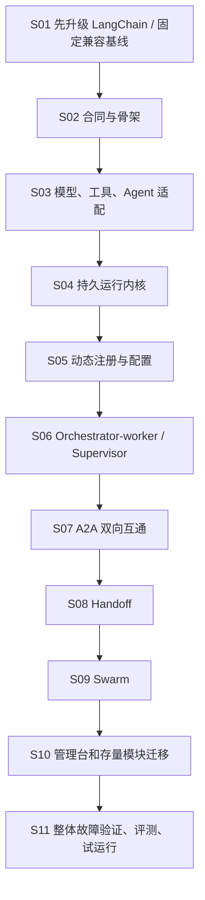

# 当前架构到多智能体运行平台：改造总计划

版本：v1.0 · 编制日期：2026-11-12（Asia/Shanghai）。状态：**计划已编写，S01–S11 均未实施**。

本目录将[当前架构](../current-architecture.md)逐步迁移到[目标六层架构](../ai-archtect/01-platform-architecture.md)。设计依据为 `docs/ai-archtect`，执行顺序以本目录为准：**第一步先升级 LangChain 生态，升级通过后再建立平台骨架和迁移业务**。原方案 P0–P6 是概略分期，本计划将其细化为 S01–S11；不改变目标架构，不把旧分期当成已完成工作。

## 1. 三项执行要求

1. S01 先完成主流稳定 LangChain 1.x、配套 LangGraph、模型集成、Python 环境及旧 API 的兼容升级；不能只改版本号或先开发新平台再补升级。
2. 每一步保留可运行的前一版本，通过 Adapter、固定合同和分流逐渐迁移；每个有副作用的业务执行域只能有一个有效执行入口。
3. **每个关键步骤对应一篇重要文档。** 本次已逐篇写出目标、技术决定、任务、验收与回滚；实施时必须在该篇文档追加实际版本、改动、测试证据、问题和结论。只有计划文本不能将步骤标为完成。

本次写集仅为 `docs/task/`。下文涉及的代码目录、依赖、服务、测试、安装和部署均为后续实施计划，未在本次执行。

## 2. 改造顺序与重要文档

| 步骤 | 关键工作 / 主要架构层 | 前置条件 | 阶段形成的可运行能力 | 对应重要文档 | 当前状态 |
|---|---|---|---|---|---|
| S01 | 升级 LangChain 及配套依赖 | 无；现状盘点归入本步 | 原有主要入口在锁定的稳定 1.x 基线上通过兼容验证 | [01 · LangChain 升级方案与验证记录](01-langchain-upgrade.md) | planned |
| S02 | 公共合同、包结构、启动装配 / L1、L6 | S01 | 可启动的版本化 FastAPI 外壳和独立 Worker 入口 | [02 · 平台骨架与公共合同](02-platform-contracts-and-skeleton.md) | planned |
| S03 | 模型、工具和 Agent Adapter / L5 | S02 | 会议图可通过统一 Adapter 在本地执行 | [03 · 资源与现有 Agent 适配](03-resource-and-agent-adapters.md) | planned |
| S04 | 持久 Run/Task/Attempt / L4、L6 | S03 | 单 Agent 跨进程运行、事件查询、取消和恢复 | [04 · 运行内核与持久化](04-runtime-and-persistence.md) | planned |
| S05 | 动态注册、发现、配置发布 / L2 | S04 | 运行中加入 Agent/实例，新旧任务按版本隔离 | [05 · 注册中心与配置治理](05-agent-registry-and-configuration.md) | planned |
| S06 | Orchestrator-worker、Supervisor / L3 | S05 | 依赖并行工作、监督迭代和会议流程迁移 | [06 · 两种集中协作模式](06-orchestrator-worker-and-supervisor.md) | planned |
| S07 | A2A 双向互通 / L1、L5 | S06 | 本地与独立远端 Agent 按固定协议协作 | [07 · A2A 通讯与互通验证](07-a2a-integration.md) | planned |
| S08 | Handoff / L3、L4 | S07 | 会话控制权可原子转交给本地或远端 Agent | [08 · Handoff 控制权转交](08-handoff.md) | planned |
| S09 | Swarm / L3、L4 | S08 | 共享任务板、自主认领、交叉审阅和有界收敛 | [09 · Swarm 协作与收敛](09-swarm.md) | planned |
| S10 | 管理台、Chat 和其余模块迁移 / L1、L5 | S09 | 用户经平台管理和运行任务，旧模块接入有明确清单 | [10 · 应用入口与存量模块迁移](10-console-and-module-migration.md) | planned |
| S11 | 端到端、故障、质量、部署与回滚 / 全层 | S10 | 有证据的试运行候选和交接包 | [11 · 整体验证与试运行交付](11-integration-and-rollout.md) | planned |

核心顺序：

## 3. 每一阶段保留什么、替换什么

| 迁移节点 | 继续保留 | 新增或替换 | 暂不宣称具备 |
|---|---|---|---|
| S01 后 | 原有业务和独立入口 | 依赖锁、兼容导入、必要 API 迁移、行为回归 | 新平台、动态注册、持久恢复 |
| S03 后 | 旧应用作为对照入口 | 公共合同、统一资源/Agent Adapter；先整图包裹会议流程 | 分布式调度和跨进程恢复 |
| S05 后 | 已适配的本地能力 | 平台统一 Runtime、Registry、配置发布 | 四种模式都已交付 |
| S09 后 | 公共内核与 Adapter | 四种模式及远程 A2A 能力 | 完整前后端切换、生产验收 |
| S11 后 | 可回滚制品和历史证据 | 已验证的新入口、部署/恢复流程 | 未实际验证的生产稳定性或业务收益 |

旧入口与平台入口采用互斥路由或独立测试数据，禁止双重消费同一有副作用任务。停止旧入口前，先核对在途运行、工件和历史访问方式；不是删除原目录就算迁移完成。

## 4. 工程组织和版本原则

- 原有子项目保留独立环境；S01 固定兼容版本合同，不把 LlamaIndex、MCP、UI 和平台强塞进同一个环境。
- S01 为现有 LangChain 消费模块更新依赖与锁；S02 再新增 `platform/src/agent_platform` 和平台自己的 `pyproject.toml/uv.lock`。`platform` 仅为目录名，Python 包使用 `agent_platform`。
- 新平台使用模块化单体源码结构，API 与 Worker 分进程运行。先落 PostgreSQL、事务任务表、事件和对象存储接口，扩容需求得到验证后再增加专用消息中间件。
- 公共合同先固定：Registry 负责能力和资格，Pattern 决定委派，Runtime 执行并持久化，Adapter 连接框架/远端，模型文本不能直接修改 owner 或授权。
- 身份、租户、secret 引用、预算和观测随模块逐步接入；不能等到 S11 才开始。

## 5. 步骤与文档完成标准

每步开始时记录当前 HEAD、dirty 状态、依赖锁 hash 和输入合同版本，不能沿用本计划编写日的源码假定。主要源码定位见[当前架构](../current-architecture.md)。

| 检查项 | 该步骤重要文档中必须出现的内容 |
|---|---|
| 目的与架构变化 | 改造前后关系图、对应层次、采用和放弃的方案及原因 |
| 实施范围 | 实际修改文件/模块、公共接口、数据/配置迁移与兼容期限 |
| 版本与证据 | 精确 Python/依赖/协议/制品版本、lock/hash、命令和脱敏回执 |
| 验证 | 成功路径、失败/重启/取消路径；mock、真实内部集成、真实外部调用分别记录 |
| 回滚 | 触发条件、可执行回退步骤、在途任务和副作用对账、回退后的验证 |
| 结论与交接 | 未解决问题、风险、下一消费者；执行完成与业务验收分开 |

步骤状态使用 `planned → implementing → verifying → completed`；不能满足通过条件时保持 verifying 或记录 blocked 的具体外部条件。`completed` 必须同时有实现、所需证据和更新后的重要文档；不要求为普通可逆动作逐次向用户确认。真实模型/工具/部署依照当时授权和环境进行，缺失项明确 not_run，不填充通过结果。

## 6. 排期和跟踪

以 2 名熟悉 Python/Agent 的工程师、共享 QA/运维支持估算：S01 约 3–5 个工作日，S02–S05 约 3–4 周，S06–S09 约 4–5 周，S10–S11 约 2–3 周，总体约 10–13 周。是粗估，不是实际承诺；S01 依赖兼容结果、业务容量/预算和现有缺陷会改变排期。

业务端到端延迟、并发、成功率、成本预算和部署环境在 S02 固定；S01 只负责旧功能的兼容升级基线。每步以可演示切片交付，新增阻断写入对应文档，不以文档数量或测试数量代替能力完成。

本次仅针对计划文档的检查见[文档交付检查](validation.md)，不等同于上述工程验收。
